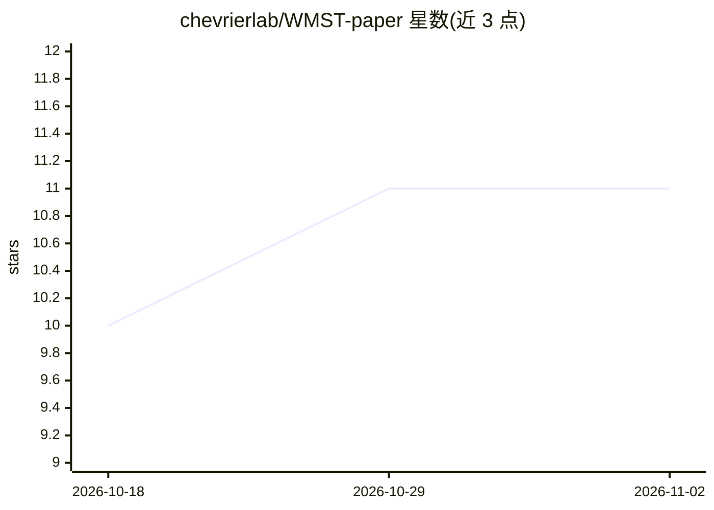

# chevrierlab/WMST-paper

⭐ 11 · Jupyter Notebook · MIT · 推送 2025-12-19 · [GitHub](https://github.com/chevrierlab/WMST-paper) · [官网](https://doi.org/10.24433/CO.3645054.v1) · 组织维护

**小鼠全身体切片图谱论文的分析代码仓库**

与手稿《Molecular and cellular cartography of the laboratory mouse using whole-body sections》配套的代码快照仓库。包含 LABEL 流程（基于空间感知的组织学分类）代码，用于对组织、组织区域与细胞类型做基于组织学切片的标注；另含空间转录组学分析脚本与 notebook（预处理、聚类、差异表达、基因调控网络等下游分析）。运行环境为 R 4.3.3 与 Python（Scanpy/AnnData）。处理后的数据与大图像文件不在仓库内，数据获取方式见手稿；LABEL 可在 Code Ocean 上复现运行。

## 筛选速览

| 维度 | 判定 | 备注 |
|---|---|---|
| AI 角色 | `ai-native` | 本体是模型或模型工具 |
| 许可风险 | `permissive` | MIT |
| 部署形态 | `None` |  |
| 模型依赖 | — | README 未给出锁定关系 |
| 硬件要求 | — | 无带数字的原话,不猜 |
| 安装摩擦 | `low` | 无编译、无系统依赖或容器化 |
| 成熟度 | `idea` | |

## 能力要点

- LABEL 流程：基于组织学切片做组织/区域/细胞类型标注
- 空间转录组下游分析脚本与 notebook（聚类、差异表达、基因调控网络）
- LABEL 提供 Code Ocean 复现运行入口

## 适用场景

- 复现论文中小鼠分子与细胞图谱的分析
- 参考 LABEL 流程做组织学切片的自动标注
- 开展空间转录组学下游分析

## 场景标签

`科研工具` · 领域:学习与行业

## 证据(README 行号)

> L12:  Code for the **LABEL pipeline** (Spatially Aware Histology-Based Classification), used for histology-based tissue,
> L15:  Analysis scripts and notebooks for preprocessing, clustering, differential expression, gene regulatory network ana

## 星数曲线

2026-10-18 10 → 2026-11-02 11（+1）

---
*卡片 v1 · prompt 1.4 · 生成 2026-11-02 · 置信度 mid · 依据 README sha `a470f2e7c7e4` · [字段定义](../../DATASET.md)*
