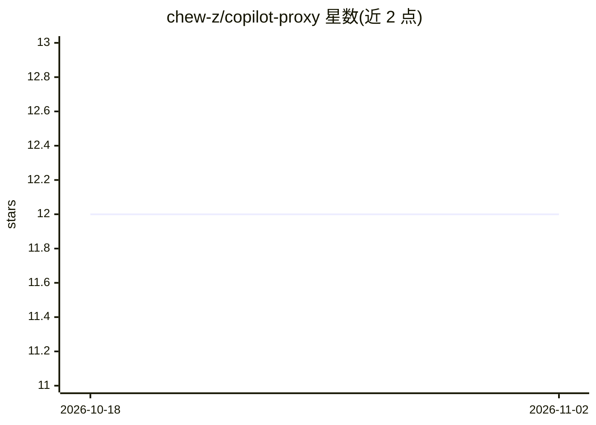

# chew-z/copilot-proxy

⭐ 12 · Go · 推送 2026-01-29 · [GitHub](https://github.com/chew-z/copilot-proxy) · 个人维护 · 中文 README

**单二进制代理：把 Ollama 兼容工具接入 Z.AI GLM 模型**

Go 编写、单二进制分发的本地代理服务器：监听 11434 端口，模拟 Ollama API（模型发现、/api/chat 等），将请求转发至 Z.AI GLM Coding PaaS，并提供 OpenAI 兼容的 /v1/chat/completions 端点。支持 SSE 流式输出、连接池优化、优雅停机；自动注入 thinking 参数启用推理，GLM-4.7 系列提供 200k 上下文与函数调用。面向使用 VS Code Copilot 等 Ollama/OpenAI 兼容客户端的开发者，通过 make build 从源码构建，含 macOS launchd 服务安装脚本。

## 筛选速览

| 维度 | 判定 | 备注 |
|---|---|---|
| AI 角色 | `ai-ecosystem` | LLM/agent 周边工具 |
| 许可风险 | `none` | — |
| 部署形态 | `None` |  |
| 模型依赖 | local-ok | 支持本地模型 |
| 硬件要求 | — | 无带数字的原话,不猜 |
| 安装摩擦 | `medium` | 含编译或系统依赖之一 |
| 成熟度 | — | 结构信号不足 |

## 能力要点

- 监听 11434 端口，作为 Ollama 的替代端点供本地工具接入
- 同时提供 OpenAI 兼容的 /v1/chat/completions 与 Ollama 风格 /api/chat
- 自动注入 thinking 参数启用推理；GLM-4.7 系列支持 200k 上下文与函数调用
- SSE 流式输出、连接池优化与优雅停机

## 适用场景

- 让 VS Code Copilot 等 Ollama 兼容客户端调用 Z.AI GLM 模型
- 在本地以 Ollama 风格 API 统一接入 GLM-4.7 系列
- 以 macOS launchd 服务方式常驻运行代理

## 场景标签

`模型网关` · 领域:Agent 开发

## 证据(README 行号)

> L3: A fast, single-binary proxy server that bridges local LLM tools (expecting Ollama/OpenAI APIs) to Z.AI GLM Coding Pa
> L123: To satisfy Ollama-compatible clients (like Copilot and various WebUIs), the proxy implements the full discovery AP

## 星数曲线

2026-10-18 12 → 2026-11-02 12（+0）

---
*卡片 v1 · prompt 1.4 · 生成 2026-11-01 · 置信度 high · 依据 README sha `5b966638eb50` · [字段定义](../../DATASET.md)*
