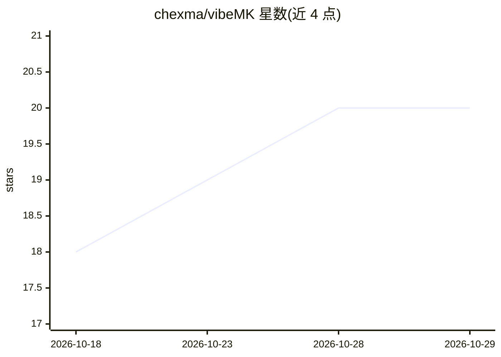

# chexma/vibeMK

⭐ 20 · Python · GPL-3.0 · 推送 2026-10-03 · [GitHub](https://github.com/chexma/vibeMK) · 个人维护

**通过 LLM 自然语言管理 CheckMK 监控环境的 MCP 服务器**

Python 实现的 MCP 服务器，将 CheckMK 2.3+ 的监控操作暴露给 LLM 客户端：实时主机/服务状态与性能指标查询、停机计划管理、问题确认、配置管理（文件夹/规则/时间周期/主机组）以及用户与密码管理。支持 stdio 本地由客户端拉起，也可经 Streamable HTTP 中心化部署多客户端共享，需 Bearer token。提供 --read-only 只读模式限制写操作。作者声明处于 alpha 阶段，使用者风险自担。

## 筛选速览

| 维度 | 判定 | 备注 |
|---|---|---|
| AI 角色 | `ai-ecosystem` | LLM/agent 周边工具 |
| 许可风险 | `viral` | GPL-3.0 |
| 部署形态 | `library` | 以包/库形式分发 |
| 模型依赖 | — | README 未给出锁定关系 |
| 硬件要求 | — | 无带数字的原话,不猜 |
| 安装摩擦 | `low` | 无编译、无系统依赖或容器化 |
| 成熟度 | `idea` | |

## 能力要点

- 实时主机/服务状态与性能指标读取
- 停机计划与问题确认管理（含时长解析 '2h'/'1h30m'）
- 支持 2000+ CheckMK 规则集类型的规则创建
- stdio 本地运行与 HTTP 中心化部署两种模式，支持只读模式

## 适用场景

- 运维人员通过对话查询和处理监控告警
- 用自然语言创建主机、规则与停机计划
- 团队共用一个中心化 MCP 实例管理 CheckMK

## 场景标签

 · 领域:运维监控/LLM 工具

## 证据(README 行号)

> L3: **CheckMK Monitoring via LLM - Professional MCP Server**
> L15: vibeMK enables complete management of your CheckMK monitoring environment directly through LLM interfaces using nat
> L66: **Centrally.** One instance can serve many clients over Streamable HTTP, so

## 星数曲线

2026-10-18 18 → 2026-10-29 20（+2）

---
*卡片 v1 · prompt 1.4 · 生成 2026-10-28 · 置信度 high · 依据 README sha `4b42fb054b61` · [字段定义](../../DATASET.md)*
