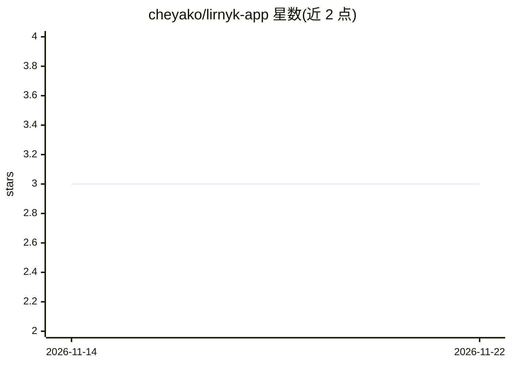

# cheyako/lirnyk-app

⭐ 3 · Swift · GPL-3.0 · 推送 2026-11-08 · [GitHub](https://github.com/cheyako/lirnyk-app) · [官网](https://lirnyk.app/?ref=github) · 个人维护

**macOS 菜单栏应用：一个热键用 AI 改写任意应用中选中文本**

面向 macOS 用户的 AI 写作工具：选中任意应用中的文本后按全局热键，应用读取选区、以配置文件的 prompt 作为系统提示发送给所选 AI 服务商，并将改写结果原地粘贴替换，支持 ⌘Z 撤销。支持 OpenRouter、OpenAI、Anthropic、Gemini 的 API key，也可通过本地 Ollama 完全离线运行。以菜单栏应用形式运行（无 Dock 图标、默认登录启动），API key 存于 Keychain，需授予辅助功能权限；提供公证 DMG 与 Homebrew 安装，也可从源码用 make 构建。

## 筛选速览

| 维度 | 判定 | 备注 |
|---|---|---|
| AI 角色 | `ai-native` | 本体是模型或模型工具 |
| 许可风险 | `viral` | GPL-3.0 |
| 部署形态 | `desktop` | 安装包/桌面程序 |
| 模型依赖 | local-ok | 支持本地模型 |
| 硬件要求 | — | 无带数字的原话,不猜 |
| 安装摩擦 | `medium` | 含编译或系统依赖之一 |
| 成熟度 | — | 结构信号不足 |

## 能力要点

- 全局热键触发选中文本的原地 AI 改写，⌘Z 可撤销
- 多服务商支持：OpenRouter/OpenAI/Anthropic/Gemini，或本地 Ollama 离线
- Profile 机制：每个配置文件绑定热键与 prompt，控制输出风格与语言
- API key 存于 Keychain，请求期间有 HUD 进度与 Esc 取消

## 适用场景

- 在邮件或聊天应用中一键改写回复语气
- 配置 Friendly/Corporate/Tech 等风格热键切换写作风格
- 用本地 Ollama 模型离线改写敏感文本

## 场景标签

`AI 写作` · 领域:内容生成

## 证据(README 行号)

> L5: macOS menu-bar app that rewrites the selected text in any app with AI: OpenRouter, OpenAI, Anthropic, Gemini, or a l
> L14: 3. It sends the text to the selected AI provider. The profile's prompt is the system prompt and the selected text i

## 星数曲线

2026-11-14 3 → 2026-11-22 3（+0）

---
*卡片 v1 · prompt 1.4 · 生成 2026-11-22 · 置信度 high · 依据 README sha `f9ee47c56833` · [字段定义](../../DATASET.md)*
