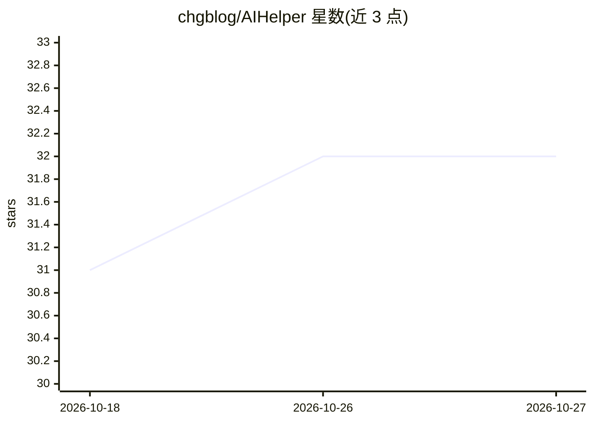

# chgblog/AIHelper

⭐ 32 · C# · GPL-3.0 · 推送 2026-10-15 · [GitHub](https://github.com/chgblog/AIHelper) · 个人维护 · 中文 README

**Windows 桌面 AI 助手：划词/快捷键调用网页大模型处理文本**

基于 WPF 与 WebView2 的 Windows 桌面工具，将 ChatGPT、Claude、Gemini、DeepSeek、Qwen、智谱、Kimi 等 7 个网页版 AI 平台嵌入统一界面。通过选中文本浮出工具栏、全局快捷键与动作面板，执行翻译、解释、总结、润色、语法检查；靠 injector.js 脚本注入定位网页输入框并自动提交，可按动作路由到不同平台，并为每个平台独立配置代理。另含浏览器模式、模拟人工滚动与自动访问、CSV 驱动的批量图像生成、配置备份。需 .NET Framework 4.8，Windows 10/11 运行。

## 筛选速览

| 维度 | 判定 | 备注 |
|---|---|---|
| AI 角色 | `ai-native` | 本体是模型或模型工具 |
| 许可风险 | `viral` | GPL-3.0 |
| 部署形态 | `desktop` | 安装包/桌面程序 |
| 模型依赖 | locked-api |  |
| 硬件要求 | — | 无带数字的原话,不猜 |
| 安装摩擦 | `medium` | 含编译或系统依赖之一 |
| 成熟度 | — | 结构信号不足 |

## 能力要点

- 划词浮出工具栏 + 7 组全局快捷键，一键执行翻译/解释/总结/润色/语法检查
- 内置 7 个网页 AI 平台预设，每个动作可独立绑定平台路由
- injector.js 脚本注入自动定位输入框并提交，支持自动新建会话
- CSV 驱动批量图像生成，含页面预设录制与失败重试

## 适用场景

- 在任何应用中划词即翻译或解释文本，不切换窗口
- 为不同任务绑定不同 AI 平台（如 DeepSeek 翻译、Claude 润色）
- 按 CSV 批量生成图像并自动保存

## 场景标签

`AI 助手` `图像生成` · 领域:对话与助手

## 证据(README 行号)

> L7: Stop copying, pasting, and switching tabs. AIHelper seamlessly embeds leading LLMs (ChatGPT, Claude, Gemini, DeepSee
> L57:  - Built-in preset support for 7 major AI platforms: **DeepSeek**, **Claude**, **Gemini**, **ChatGPT**, **Qwen**, *
> L104:  - Built with WPF and Microsoft WebView2 for a smooth web browsing and interaction experience.

## 星数曲线

2026-10-18 31 → 2026-10-27 32（+1）

---
*卡片 v1 · prompt 1.4 · 生成 2026-10-26 · 置信度 high · 依据 README sha `143b170fe20f` · [字段定义](../../DATASET.md)*
