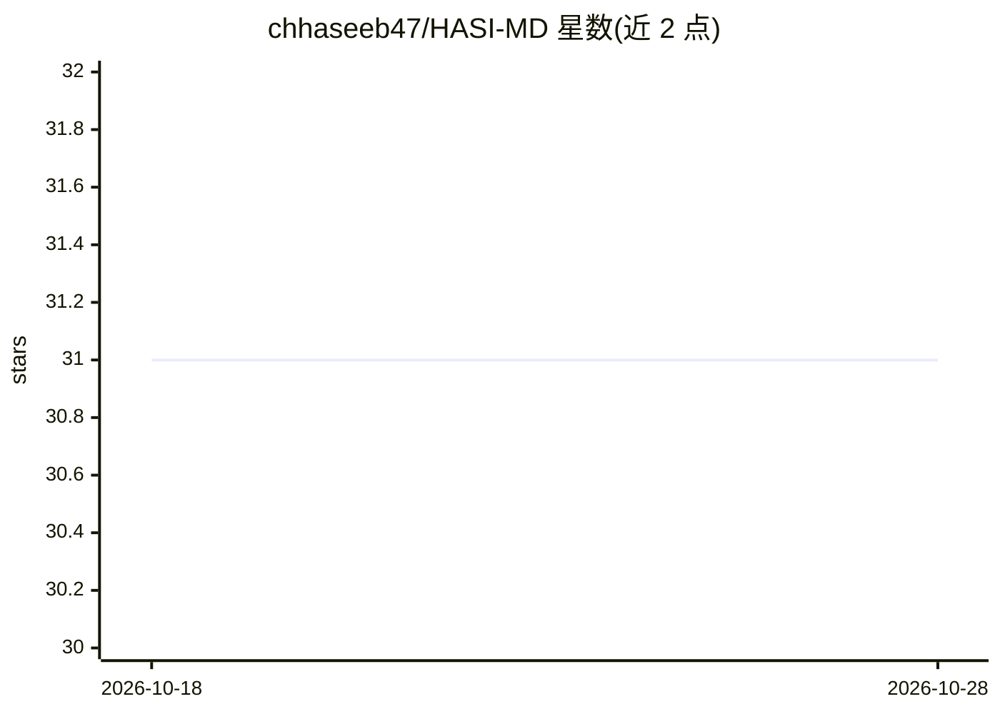

# chhaseeb47/HASI-MD

⭐ 31 · JavaScript · NOASSERTION · 推送 2026-04-23 · [GitHub](https://github.com/chhaseeb47/HASI-MD) · [官网](https://github.com/chhaseeb47/HASI-MD) · 个人维护

**基于 Baileys 的 WhatsApp 多设备机器人，含 AI 聊天功能**

基于 Baileys 库构建的 WhatsApp 多设备机器人，部署流程为：Fork 仓库、通过 Web Pairing 页面生成会话 ID、再一键部署到 Heroku。功能表列出反删除、24/7 运行、下载器、AI 聊天、群组管理、自动贴纸、游戏、贴纸制作等，AI 聊天为其中一项功能。README 声明与 WhatsApp 无隶属关系，采用 Apache 2.0 许可证。

## 筛选速览

| 维度 | 判定 | 备注 |
|---|---|---|
| AI 角色 | `ai-enhanced` | 去掉 AI 部分产品仍成立 |
| 许可风险 | `none` | NOASSERTION |
| 部署形态 | `None` |  |
| 模型依赖 | — | README 未给出锁定关系 |
| 硬件要求 | — | 无带数字的原话,不猜 |
| 安装摩擦 | `low` | 无编译、无系统依赖或容器化 |
| 成熟度 | — | 结构信号不足 |

## 能力要点

- 基于 Baileys 的 WhatsApp 多设备协议实现
- Web Pairing 生成会话 ID
- Heroku 一键部署模板
- 功能含 AI 聊天、反删除、下载器、贴纸制作等

## 适用场景

- 在 WhatsApp 群组中运行自动化机器人
- 需要 24/7 在线的消息处理与下载功能
- 通过 AI 聊天功能在 WhatsApp 内对话

## 场景标签

`聊天机器人` · 领域:对话与助手

## 证据(README 行号)

> L15: "> Built on Baileys • Designed for Speed • Enhanced for Stability •
> L42: |🧠 AI Chat|✅|

## 星数曲线

2026-10-18 31 → 2026-10-28 31（+0）

---
*卡片 v1 · prompt 1.4 · 生成 2026-10-26 · 置信度 mid · 依据 README sha `86236a563cc3` · [字段定义](../../DATASET.md)*
