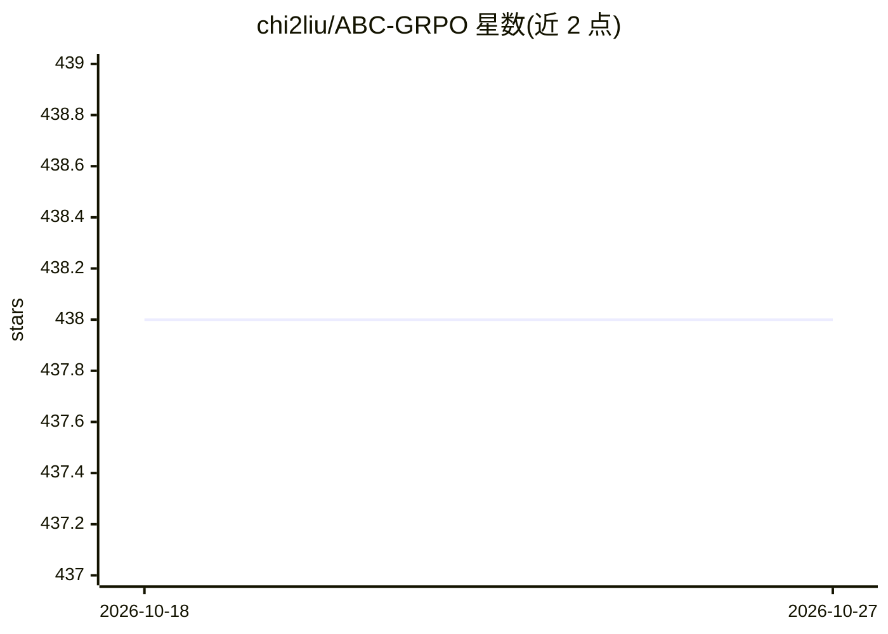

# chi2liu/ABC-GRPO

⭐ 438 · Python · Apache-2.0 · 推送 2026-09-08 · [GitHub](https://github.com/chi2liu/ABC-GRPO) · [官网](https://arxiv.org/pdf/2601.03895) · 组织维护

**面向 LLM 强化学习的 GRPO 改进算法（4 边界裁剪）官方代码**

论文配套代码：提出 Adaptive-Boundary-Clipping GRPO，用 4 个独立裁剪参数（ε₁–ε₄）替代 GRPO 的 2 个条件边界，对 (r, Â) 四个象限提供无条件有界更新，声称缓解 Q4 象限过度抑制导致的熵坍缩与 Pass@k 退化。以 TRL 0.25.1 的分支实现，提供 uv 环境搭建、sh/ 目录预配置训练脚本、recipes/ 配置及 eval_math 自动评估脚本（AIME/AMC/HMMT）。基准实验基于 Qwen3-1.7B/4B-Base。训练需 GPU（脚本按 GPU ID 指定）。

## 筛选速览

| 维度 | 判定 | 备注 |
|---|---|---|
| AI 角色 | `ai-ecosystem` | LLM/agent 周边工具 |
| 许可风险 | `permissive` | Apache-2.0 |
| 部署形态 | `None` |  |
| 模型依赖 | — | README 未给出锁定关系 |
| 硬件要求 | — | 无带数字的原话,不猜 |
| 安装摩擦 | `low` | 无编译、无系统依赖或容器化 |
| 成熟度 | — | 结构信号不足 |

## 能力要点

- 4 个独立裁剪参数替代 GRPO 的 2 个条件边界
- 以 TRL 0.25.1 分支形式实现，提供预配置训练脚本
- eval_math 脚本自动评估 checkpoint 的 Avg@k 与 Pass@k
- 实验基于 Qwen3-1.7B/4B-Base，评测覆盖 AIME/AMC/HMMT

## 适用场景

- 复现论文中 ABC-GRPO 与 GRPO 基线的训练与评测
- 在数学推理 RLVR 任务上尝试 4 边界裁剪训练
- 对比不同裁剪策略下的熵保持与 Pass@k 变化

## 场景标签

`强化学习` · 领域:训练与推理

## 证据(README 行号)

> L15: Group Relative Policy Optimization (GRPO) has emerged as a popular algorithm for reinforcement learning with large 
> L106: ABC-GRPO is implemented as a branch of TRL (Transformer Reinforcement Learning) library based on version 0.25.1. T

## 星数曲线

2026-10-18 438 → 2026-10-27 438（+0）

---
*卡片 v1 · prompt 1.4 · 生成 2026-10-22 · 置信度 high · 依据 README sha `7508052a4dff` · [字段定义](../../DATASET.md)*
