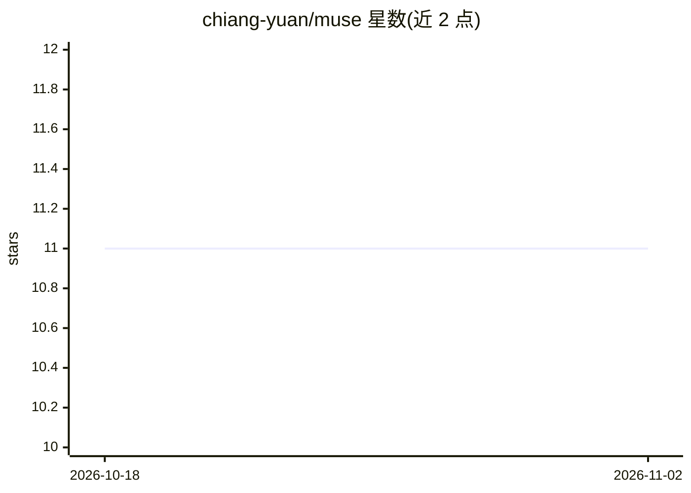

# chiang-yuan/muse

⭐ 11 · Python · MIT · 推送 2026-04-22 · [GitHub](https://github.com/chiang-yuan/muse) · [官网](https://chiang-yuan.github.io/muse/) · 个人维护

**从 Materials Project 结构快速构建无定形固体与液体混合物的 Python 包**

面向计算材料学研究者的结构构建工具：读取 Materials Project 弛豫固态结构，用 Packmol 将分子装箱生成二元/多元无定形混合物；支持 NVT→NPT 分子动力学流程以机器学习原子间势（MACE、CHGNet 等 UI 势）计算平衡密度；提供混合焓、密度–组成、超额体积等热力学分析与 Redlich–Kister 拟合，并可程序化提交 SLURM 作业。需 Python 3.10+、Packmol 与 MP API key。

## 筛选速览

| 维度 | 判定 | 备注 |
|---|---|---|
| AI 角色 | `ai-native` | 本体是模型或模型工具 |
| 许可风险 | `permissive` | MIT |
| 部署形态 | `library` | 以包/库形式分发 |
| 模型依赖 | — | README 未给出锁定关系 |
| 硬件要求 | — | 无带数字的原话,不猜 |
| 安装摩擦 | `low` | 无编译、无系统依赖或容器化 |
| 成熟度 | — | 结构信号不足 |

## 能力要点

- 从 Materials Project 晶体结构生成二元/多元无定形混合物
- 基于 MACE/CHGNet 等机器学习势的 NVT→NPT 密度平衡流程
- 混合焓/密度–组成/超额体积图与 Redlich–Kister 拟合
- 程序化提交 SLURM 批处理作业

## 适用场景

- 我要为分子动力学模拟准备无定形或液体混合物的初始构型
- 我要用机器学习势计算混合体系的平衡密度
- 我要分析二元混合体系的热力学性质随组成的变化

## 场景标签

`科研工具` · 领域:学习与行业

## 证据(README 行号)

> L10: **Muse** (**M**ixture b**u**ilder for **s**imulation **e**nvironments) is a Python package for rapidly building amo
> L15: - **Density equilibration** — Run NVT → NPT molecular dynamics workflows to compute equilibrium densities with `Den

## 星数曲线

2026-10-18 11 → 2026-11-02 11（+0）

---
*卡片 v1 · prompt 1.4 · 生成 2026-11-02 · 置信度 high · 依据 README sha `f42cdee3a76b` · [字段定义](../../DATASET.md)*
