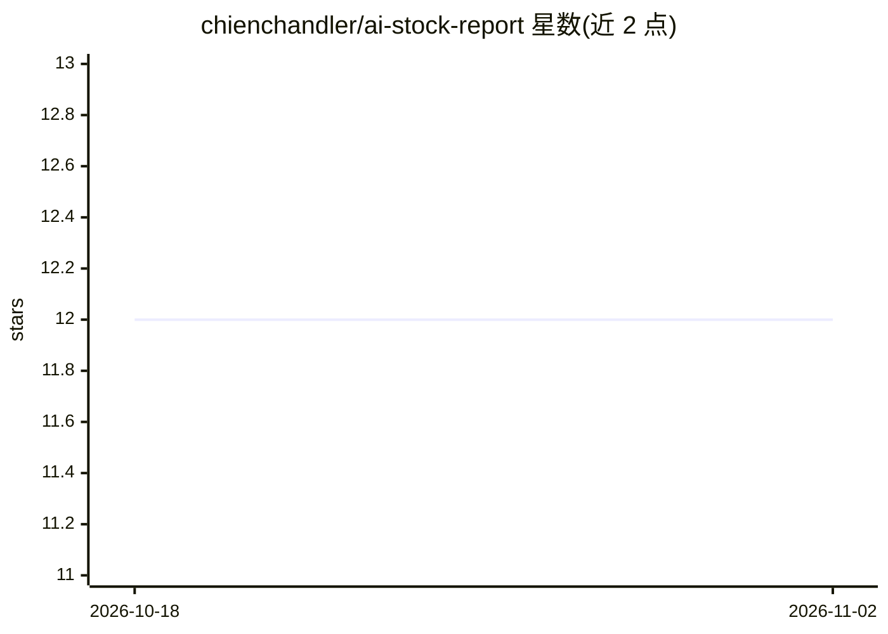

# chienchandler/ai-stock-report

⭐ 12 · Python · Apache-2.0 · 推送 2026-03-17 · [GitHub](https://github.com/chienchandler/ai-stock-report) · 个人维护 · 中文 README

**散户的 A 股持仓 AI 分析工具：每日自动评分并发邮件报告**

面向 A 股散户的个人自动化分析工具：按设定时间定时运行，获取 K 线与技术指标（MA/RSI/量能）、估值（PE/PB）、新闻（东方财富/雪球免费源，可选 Brave/Tavily）与资金动向数据，交给大模型（推荐 DeepSeek，也支持 OpenRouter、硅基流动）综合分析，对每只股票给出 -5 到 +5 评分与风险提示，生成 HTML 报告通过 SMTP 发送邮箱。数据与 API Key 保存在本地。提供双击启动、浏览器配置页面与命令行三种使用方式。声明分析仅供参考，不构成投资建议。

## 筛选速览

| 维度 | 判定 | 备注 |
|---|---|---|
| AI 角色 | `ai-native` | 本体是模型或模型工具 |
| 许可风险 | `permissive` | Apache-2.0 |
| 部署形态 | `library` | 以包/库形式分发 |
| 模型依赖 | locked-api |  |
| 硬件要求 | — | 无带数字的原话,不猜 |
| 安装摩擦 | `low` | 无编译、无系统依赖或容器化 |
| 成熟度 | — | 结构信号不足 |

## 能力要点

- 定时综合 K 线、技术指标、新闻、估值与资金动向，输出 -5~+5 评分报告
- 数据全在本地，新闻源默认免费，50 只股票约 ￥0.5/天（DeepSeek API）
- 多源数据容错、断点续传、429 限速退避
- 零代码安装：双击启动脚本 + 浏览器填表配置

## 适用场景

- 每天早上在邮箱收到 A 股持仓的综合分析报告
- 不用盯盘即可了解关注股票的评分变化与风险提示
- 自定义分析偏好（如价值投资/技术面）生成个性化报告

## 场景标签

`金融量化` · 领域:学习与行业

## 证据(README 行号)

> L14: **AI Stock Report** 就是你的私人 AI 研究员 —— 每天自动综合 K 线走势、技术指标、新闻资讯、估值数据，对你关注的每只股票给出评分和分析要点，生成一份报告发到你的邮箱。
> L46: 所有数据汇总后交给大模型做综合判断，给出评分和分析要点。
> L132: 定时触发 → 获取行情数据 → 搜索新闻 → 计算技术指标 → LLM 综合分析 → 生成 HTML 报告 → 邮件发送

## 星数曲线

2026-10-18 12 → 2026-11-02 12（+0）

---
*卡片 v1 · prompt 1.4 · 生成 2026-11-01 · 置信度 mid · 依据 README sha `919bffda1f67` · [字段定义](../../DATASET.md)*
