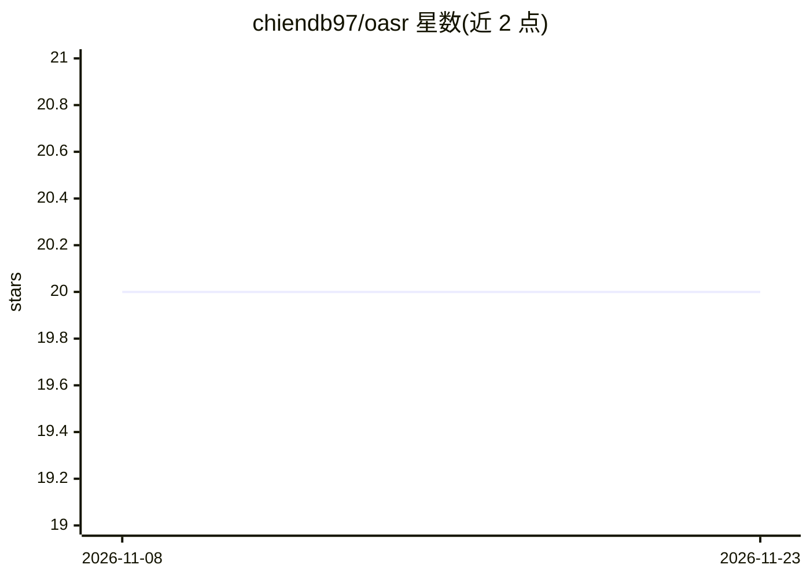

# chiendb97/oasr

⭐ 20 · Python · Apache-2.0 · 推送 2026-11-20 · [GitHub](https://github.com/chiendb97/oasr) · [官网](https://chiendb97.github.io/oasr/) · 个人维护

**NVIDIA GPU 上的 ASR 推理与服务引擎：统一托管多架构语音识别模型**

开源的语音识别推理与服务引擎，在 NVIDIA GPU（Turing 至 Blackwell，SM75–SM120）上直接加载 Whisper、WeNet Conformer、icefall Zipformer/RNN-T、Nemotron ASR、FunASR Paraformer、Qwen2-Audio 等多种格式的 checkpoint，无需 ONNX/TensorRT 导出。基于自研 CUDA/CUTLASS 内核，支持离线与实时流式识别、动态批处理、CUDA graph、W8A8 int8/fp8 量化；通过 Rust 前端提供 OpenAI 兼容 HTTP API、WebSocket 与 gRPC。从源码安装，需 CUDA≥11.8、CMake、Rust 工具链，提供 Docker 构建方式。服务器自身无认证、不终止 TLS，需置于私网或反代之后。

## 筛选速览

| 维度 | 判定 | 备注 |
|---|---|---|
| AI 角色 | `ai-ecosystem` | LLM/agent 周边工具 |
| 许可风险 | `permissive` | Apache-2.0 |
| 部署形态 | `self-host` | docker 或自建部署 |
| 模型依赖 | — | README 未给出锁定关系 |
| 硬件要求 | — | 无带数字的原话,不猜 |
| 安装摩擦 | `low` | 无编译、无系统依赖或容器化 |
| 成熟度 | — | 结构信号不足 |

## 能力要点

- 七种架构、五类解码族（CTC/RNN-T/AED/CIF/speech-LLM），checkpoint 免转换直接加载
- OpenAI 兼容 /v1/audio/transcriptions API，官方 openai SDK 换 base URL 即可使用
- 流式识别支持 WebSocket、SSE 与 gRPC 双向流，多流在 GPU 上动态批处理
- W8A8 int8/fp8 量化（含 SmoothQuant 校准）与 fp8 KV cache

## 适用场景

- 自建兼容 OpenAI SDK 的语音转文字 API 服务，替换外部转写接口
- 搭建实时流式转写服务（会议、直播、电话 G.711 音频）
- 在同一服务上托管来自 WeNet/icefall/FunASR/Hugging Face 的多种 ASR 模型
- 通过量化与批处理降低 GPU 上的每音频小时转写成本

## 场景标签

`语音识别` `推理引擎` · 领域:感知与多模态

## 证据(README 行号)

> L17: **OASR** (Open Automatic Speech Recognition) is an open-source inference and serving engine for
> L20: streaming, from one engine built on custom CUDA/CUTLASS kernels, and serves them through an
> L64: - A production Rust frontend with an **OpenAI-compatible** HTTP API, a realtime WebSocket and gRPC

## 星数曲线

2026-11-08 20 → 2026-11-23 20（+0）

---
*卡片 v1 · prompt 1.4 · 生成 2026-11-18 · 置信度 mid · 依据 README sha `a52adf54350c` · [字段定义](../../DATASET.md)*
