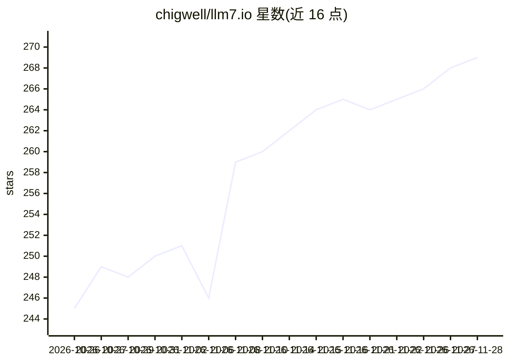

# chigwell/llm7.io

⭐ 269 · TypeScript · AGPL-3.0 · 推送 2026-11-19 · [GitHub](https://github.com/chigwell/llm7.io) · [官网](https://llm7.io/) · 组织维护

**统一 API 网关：接入多家 AI 模型的文本/图像/视频生成**

LLM7.io 提供 OpenAI 兼容的单一 API 网关，聚合多家提供商的 AI 模型，覆盖文本对话、图像生成与编辑、视频生成。使用方式为在 dash.llm7.io 获取 API token，通过 OpenAI SDK 或 curl 调用 api.llm7.io 端点；README 另提供可用模型列表、Models API 及完整文档入口。许可证为 GNU AGPL。

## 筛选速览

| 维度 | 判定 | 备注 |
|---|---|---|
| AI 角色 | `ai-ecosystem` | LLM/agent 周边工具 |
| 许可风险 | `viral` | AGPL-3.0 |
| 部署形态 | `library` | 以包/库形式分发 |
| 模型依赖 | — | README 未给出锁定关系 |
| 硬件要求 | — | 无带数字的原话,不猜 |
| 安装摩擦 | `low` | 无编译、无系统依赖或容器化 |
| 成熟度 | — | 结构信号不足 |

## 能力要点

- OpenAI 兼容 API，支持文本、图像、视频生成
- 单一端点接入多家提供商的模型
- 提供 Models API 查询可用模型
- Python SDK 与 curl 示例

## 适用场景

- 用一个 API token 调用多个 AI 模型
- 在现有 OpenAI SDK 代码中切换到聚合网关
- 调用图像与视频生成接口

## 场景标签

`模型网关` · 领域:Agent 开发

## 证据(README 行号)

> L5: LLM7.io provides an OpenAI-compatible API for text, image, and video generation.
> L9: Get an API token from dash.llm7.io.

## 星数曲线

2026-10-26 245 → 2026-11-28 269（+24）

---
*卡片 v1 · prompt 1.4 · 生成 2026-11-25 · 置信度 mid · 依据 README sha `a30c376c217f` · [字段定义](../../DATASET.md)*
