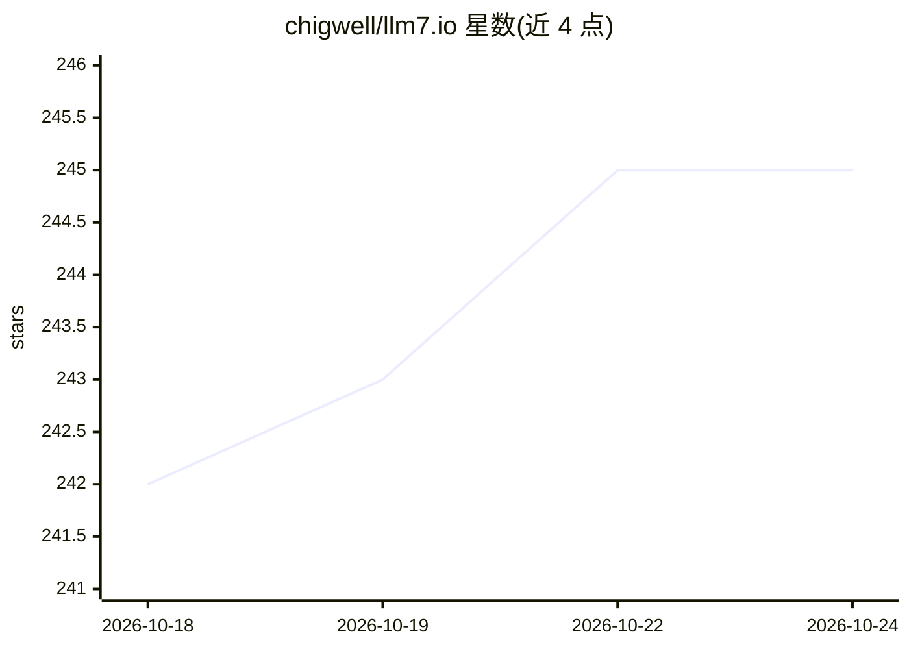

# chigwell/llm7.io

⭐ 246 · TypeScript · AGPL-3.0 · 推送 2026-10-16 · [GitHub](https://github.com/chigwell/llm7.io) · [官网](https://llm7.io/) · 个人维护

**LLM7.io 落地页源码：免费 OpenAI 兼容 LLM API 网关的门面站点**

本仓库是 LLM7.io 服务落地页（Next.js）的源码，非 API 服务本体。LLM7.io 提供免费、OpenAI 兼容的统一端点，通过 API token 访问 GPT-4、DeepSeek、Mistral 等模型，无需本地硬件。仓库内容：从公开 API 快照在构建时生成模型目录、对比、sitemap 与 OG 资产；Cloudflare Pages CI 自动部署；模型价格由浏览器实时从 api.llm7.io 读取（三分钟刷新）；含 PostHog 同意制分析与 Google Ads 归因逻辑。本地开发用 npm。

## 筛选速览

| 维度 | 判定 | 备注 |
|---|---|---|
| AI 角色 | `ai-ecosystem` | LLM/agent 周边工具 |
| 许可风险 | `viral` | AGPL-3.0 |
| 部署形态 | `library` | 以包/库形式分发 |
| 模型依赖 | — | README 未给出锁定关系 |
| 硬件要求 | — | 无带数字的原话,不猜 |
| 安装摩擦 | `low` | 无编译、无系统依赖或容器化 |
| 成熟度 | — | 结构信号不足 |

## 能力要点

- 构建时从公共 API 快照生成模型目录/对比/sitemap/OG 资产
- 模型价格浏览器端实时读取 api.llm7.io/v1/models，3 分钟刷新
- Cloudflare Pages 工作流每次推送 main 自动构建部署
- OpenAI 兼容 API，Python/Node.js/CLI 快速上手示例

## 适用场景

- 用免费 token 通过 OpenAI 兼容接口调用多种 LLM
- 无需本地重硬件体验主流模型
- 为落地页的部署、构建与数据管线做贡献或本地开发

## 场景标签

`模型网关` · 领域:Agent 开发

## 证据(README 行号)

> L5: This repository contains the source code for the landing page of LLM7.io, a free, open endpoint for accessing top LL
> L67: LLM7.io provides:

## 星数曲线

2026-10-18 242 → 2026-10-24 245（+3）

---
*卡片 v1 · prompt 1.4 · 生成 2026-10-22 · 置信度 high · 依据 README sha `e53db4b45e4b` · [字段定义](../../DATASET.md)*
