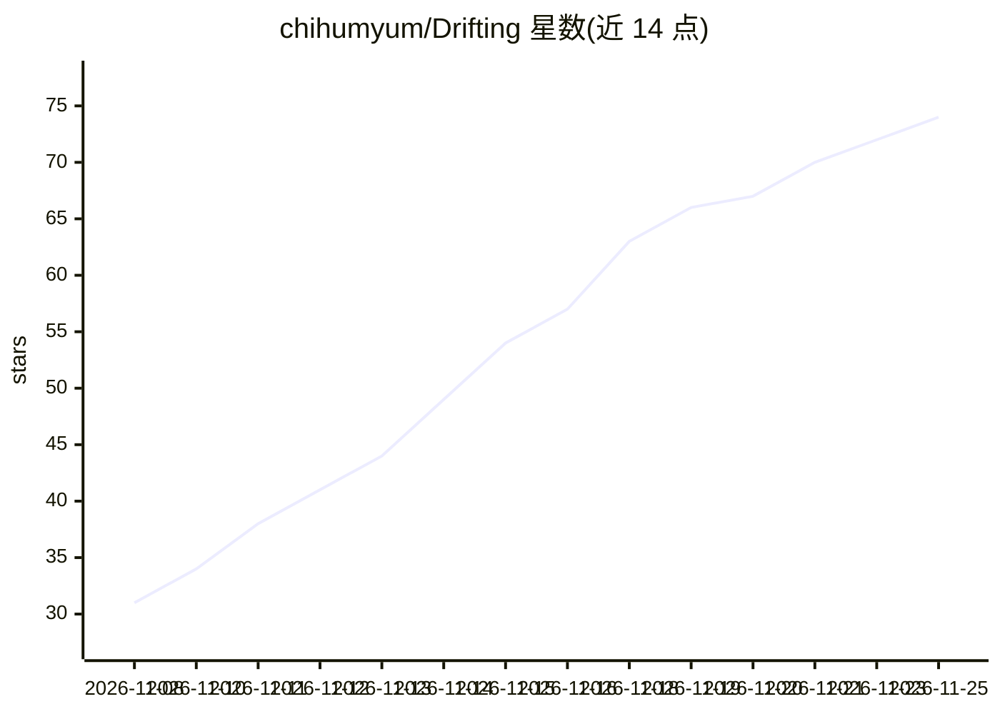

# chihumyum/Drifting

⭐ 74 · Rust · AGPL-3.0 · 推送 2026-11-23 · [GitHub](https://github.com/chihumyum/Drifting) · [官网](https://drifting.cc) · 个人维护 · 中文 README

**本地优先的 AI 原生小说写作应用，带全书 AI Agent**

面向小说作者的跨平台桌面应用（Mac/Windows，基于 Tauri/Rust/React）：以 Markdown 编辑器方式写作，提供经典写作工坊式的结构——章节与大纲、角色/地点/设定元素、故事线时间轴、研究素材、TODO 与快照历史；内置 AI Agent 可读取、搜索并编辑整个项目，其改动在文中标记且可撤销。AI 需自带 API key（DeepSeek/Anthropic/OpenAI）或 ChatGPT 订阅登录，写作本身不依赖 AI。数据本地存储、可离线使用，支持 MCP 接入 Codex/Claude Code/Antigravity 等外部 agent。AGPL-3.0 开源，自述处于早期开发阶段。

## 筛选速览

| 维度 | 判定 | 备注 |
|---|---|---|
| AI 角色 | `ai-native` | 本体是模型或模型工具 |
| 许可风险 | `viral` | AGPL-3.0 |
| 部署形态 | `desktop` | 安装包/桌面程序 |
| 模型依赖 | locked-api |  |
| 硬件要求 | — | 无带数字的原话,不猜 |
| 安装摩擦 | `low` | 无编译、无系统依赖或容器化 |
| 成熟度 | `idea` | |

## 能力要点

- AI Agent 可读取、搜索、编辑全书项目（散文、元素、关系、故事线、素材、TODO），改动可撤销
- Markdown 文件即项目：可在 Obsidian 等外部编辑器修改并合并回来
- 经典写作工坊结构：大纲、元素与关系图、故事线时间轴、情节网格、素材库
- 通过 MCP 接入 Codex、Claude Code、Antigravity 等外部 agent

## 适用场景

- 在本地离线撰写长篇小说并管理角色、设定与故事线
- 让 AI Agent 通读全书进行搜索、改写与归档整理
- 用熟悉的 Markdown 工作流（如 Obsidian）与应用双向协作
- 将书稿导出为 EPUB/PDF/Word 或分享章节网页供读者评论

## 场景标签

`AI 写作` · 领域:内容生成

## 证据(README 行号)

> L3: A cross-platform, AI-native novel-writing app.
> L27: research — and comes with an AI Agent that can read, search and edit the whole
> L83:  ChatGPT subscription (experimental). Writing never requires AI.

## 星数曲线

2026-11-08 31 → 2026-11-25 74（+43）

---
*卡片 v1 · prompt 1.4 · 生成 2026-11-18 · 置信度 mid · 依据 README sha `a95e34740c1b` · [字段定义](../../DATASET.md)*
