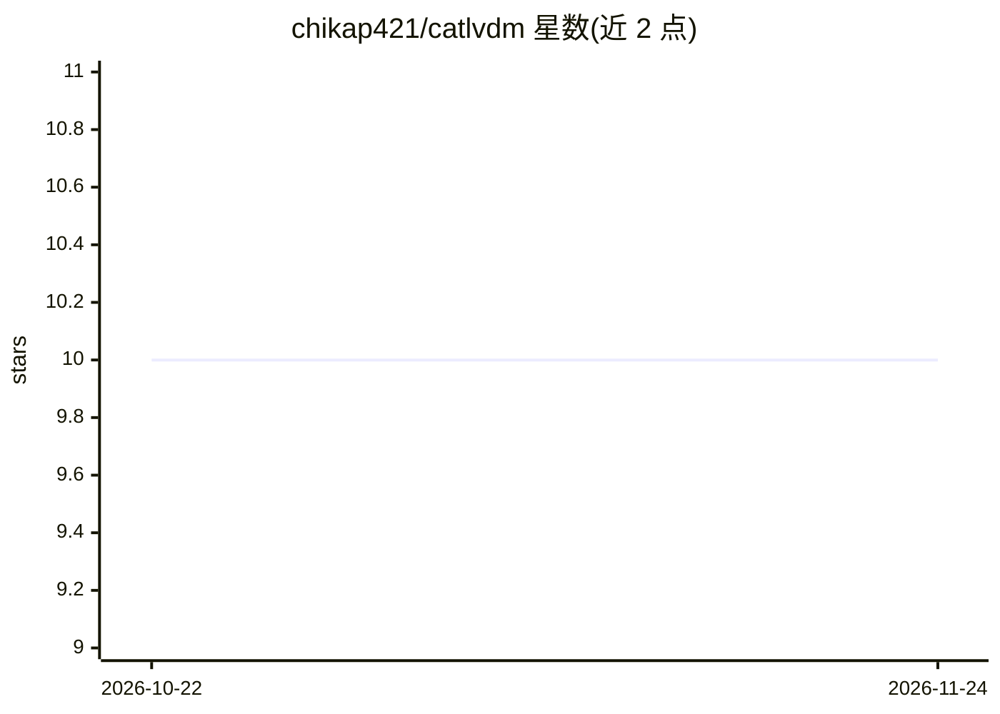

# chikap421/catlvdm

⭐ 10 · Python · MIT · 推送 2026-06-29 · [GitHub](https://github.com/chikap421/catlvdm) · [官网](https://arxiv.org/abs/2505.21545) · 个人维护

**面向研究者的文本到视频扩散模型抗噪训练参考实现**

ICLR 2026 论文 CAT-LVDM 的参考代码：通过嵌入级（BCNI/SACN/Gaussian 等）与文本级（增删换替等）结构化噪声训练潜在视频扩散模型，并附 ECCV 2026 事件驱动视频生成（EVD）模块，支持 3D U-Net 与 STDiT 类 backbone。提供 conda/pip 环境搭建、Hugging Face 多噪声强度检查点、DeepSpeed 推理与训练脚本、多 corruption 并行实验脚本及 TensorBoard 日志。不包含私有训练数据、私有检查点或 DiT-30B 全量训练栈。

## 筛选速览

| 维度 | 判定 | 备注 |
|---|---|---|
| AI 角色 | `ai-native` | 本体是模型或模型工具 |
| 许可风险 | `permissive` | MIT |
| 部署形态 | `library` | 以包/库形式分发 |
| 模型依赖 | — | README 未给出锁定关系 |
| 硬件要求 | — | 无带数字的原话,不猜 |
| 安装摩擦 | `low` | 无编译、无系统依赖或容器化 |
| 成熟度 | — | 结构信号不足 |

## 能力要点

- 嵌入级 6 种与文本级 5 种 corruption 方案，覆盖 6 档噪声强度（2.5%–20%）
- Hugging Face 发布多设置预训练检查点与下载脚本
- EVD 模块支持 3D U-Net 与 video DiT/STDiT 类 backbone 适配
- DeepSpeed 多 GPU 训练/推理与多 corruption 并行脚本

## 适用场景

- 复现论文中结构化噪声训练的视频扩散模型实验
- 在自己训练的文本到视频模型上引入 corruption-aware 训练策略
- 在 MSR-VTT、UCF101 等数据集上评测视频生成鲁棒性

## 场景标签

`视频生成` `模型训练` `模型评测` · 领域:评测与运维

## 证据(README 行号)

> L100: This repo implements **CAT-LVDM**, a corruption-aware training framework that improves the robustness of latent vi
> L16:  Reference code for CAT-LVDM and Event-Driven Video Generation (EVD), including the ECCV 2026 EVD training/inferenc
> L181: This repository supports training on the WebVid-2M training split, and inference on the WebVid-2M validation split

## 星数曲线

2026-10-22 10 → 2026-11-24 10（+0）

---
*卡片 v1 · prompt 1.4 · 生成 2026-11-19 · 置信度 high · 依据 README sha `4ffd4f38e500` · [字段定义](../../DATASET.md)*
