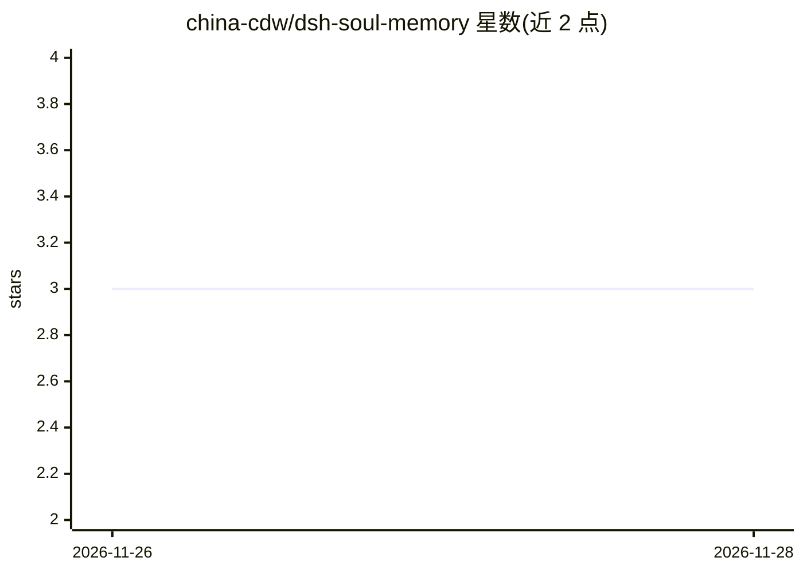

# china-cdw/dsh-soul-memory

⭐ 3 · JavaScript · AGPL-3.0 · 推送 2026-11-25 · [GitHub](https://github.com/china-cdw/dsh-soul-memory) · [官网](https://ambervouch.com/soul-memory) · 个人维护 · 中文 README

**给 DeepSeek Harness 装分层长期记忆的插件**

面向 DeepSeek Harness 宿主的记忆插件：合并核心记忆、归档笔记、会话图谱、自动踩坑记录与编码规范五层，各层独立预算与开关；提供 21 个默认注册的记忆工具（memory_write/search/recall 等），支持 ACT-R 衰减排序、取代标记、写入守卫（拒收私钥/token 形状）、每日快照、敏感信息标记与私有段摘除；可选桥接 billion-context 只读检索旧会话摘要，可选闲时整理（dreaming）由模型裁决垃圾节点。以 git clone 加 dsh plugin 命令安装，需 Node.js ≥24 与 DSH ≥0.2.1-rc.2，许可证 AGPL-3.0，闭源商用需商业授权。

## 筛选速览

| 维度 | 判定 | 备注 |
|---|---|---|
| AI 角色 | `ai-ecosystem` | LLM/agent 周边工具 |
| 许可风险 | `dual` | AGPL-3.0 |
| 部署形态 | `self-host` | docker 或自建部署 |
| 模型依赖 | — | README 未给出锁定关系 |
| 硬件要求 | — | 无带数字的原话,不猜 |
| 安装摩擦 | `low` | 无编译、无系统依赖或容器化 |
| 成熟度 | — | 结构信号不足 |

## 能力要点

- 五层记忆一次写入分流，各层独立预算与开关
- 21 个默认工具：写入查重、三路检索、证据标签、回捞原文
- 写入守卫拒收私钥块与 token 形状，敏感信息默认只露标题
- 可选 dreaming 闲时整理，AI 判垃圾节点只退休可恢复

## 适用场景

- 让 DeepSeek Harness 会话间保留偏好、约束与决策记录
- 长会话压缩后按原文指针回捞旧过程细节
- 自动记录工具报错与修正做法，避免重复踩坑
- 从 QClaw/OpenClaw/Claude Code 转录中检索过往工作

## 场景标签

`Agent 记忆` · 领域:Agent 开发

## 证据(README 行号)

> L7: > **给 DeepSeek Harness 装一套会分层、会遗忘、会回捞的长期记忆。**
> L11: 只装这一个插件，就能同时得到：常驻核心记忆、可检索的归档笔记、会话过程图谱、自动踩坑记录、项目编码规范，以及从 billion-context 会话摘要里找回旧过程的能力。几层各有自己的预算和开关，互不挤占（归档笔记只注入标题，不
> L30: - 运行要求：Node.js ≥ 24，DSH ≥ 0.2.1-rc.2

## 星数曲线

2026-11-26 3 → 2026-11-28 3（+0）

---
*卡片 v1 · prompt 1.4 · 生成 2026-11-26 · 置信度 mid · 依据 README sha `22655baf2ae3` · [字段定义](../../DATASET.md)*
