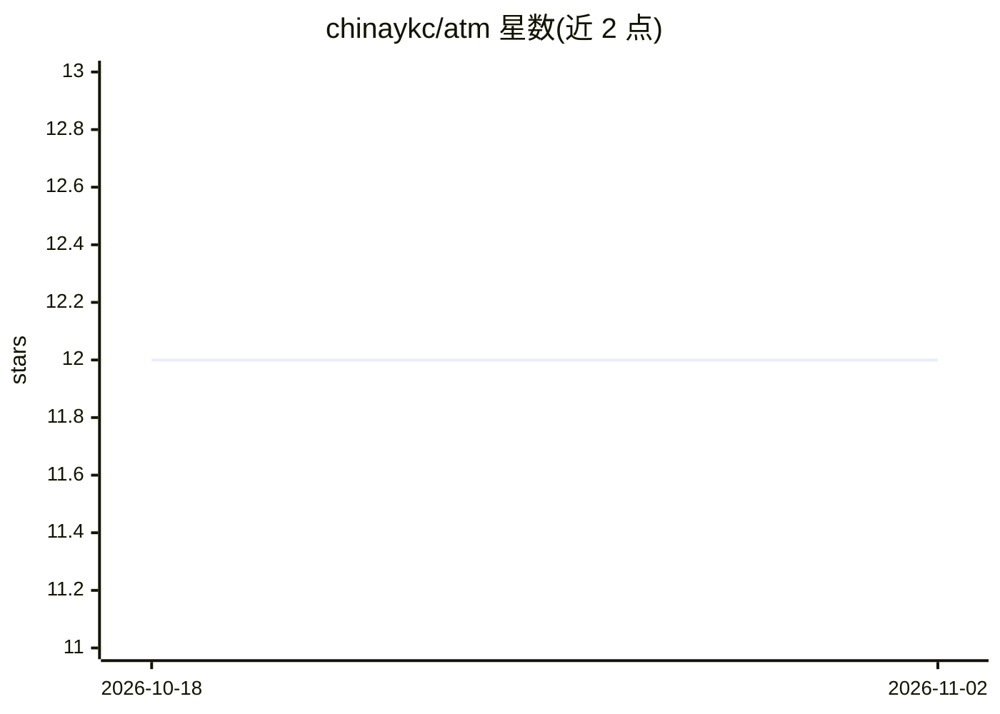

# chinaykc/atm

⭐ 12 · Go · MIT · 推送 2026-06-10 · [GitHub](https://github.com/chinaykc/atm) · 个人维护 · 中文 README

**用 Markdown 运行手册组织多个 coding agent 工作流的 CLI**

ATM（Agent Task Markdown）定义一种 Markdown 运行手册格式与配套 Go CLI：普通 Markdown 段落作为任务上下文，斜杠命令（/task、/for、/go、/wait、/if、/pool 等）描述任务的顺序执行、条件重试、并行分支与汇合。执行前将文件编译为静态计划并可视化预览，运行时通过 Codex 或 Claude Code 作为 runner 执行 agent，结构化判定（如 until 条件）经本地 MCP 端点以工具调用完成。工作流可注册为本地命令或经 serve 暴露为 HTTP API。运行依赖 PATH 上有 Codex 或 Claude Code，从 GitHub Releases 下载二进制安装，也可用 Go 1.25+ 从源码构建。

## 筛选速览

| 维度 | 判定 | 备注 |
|---|---|---|
| AI 角色 | `ai-ecosystem` | LLM/agent 周边工具 |
| 许可风险 | `permissive` | MIT |
| 部署形态 | `desktop` | 安装包/桌面程序 |
| 模型依赖 | — | README 未给出锁定关系 |
| 硬件要求 | — | 无带数字的原话,不猜 |
| 安装摩擦 | `low` | 无编译、无系统依赖或容器化 |
| 成熟度 | — | 结构信号不足 |

## 能力要点

- Markdown + 斜杠命令描述任务：顺序/重试/并行/等待等约 25 种任务命令
- 执行前编译为静态计划，`atm check --plan` 干跑预览并生成流程图
- 支持 Codex 与 Claude Code 两种 runner，结构化判定经本地 MCP 工具调用实现
- 工作流可注册为本地命令或通过 `atm serve` 暴露为同步/异步 HTTP API（含 OpenAPI 元数据）

## 适用场景

- 把重复的测试修复、文档审查等 prompt 工作固化为可复用运行手册
- 并行派发多个 agent 审计各目录并汇总结果
- 将项目日常 agent 流程暴露为本地命令或小型 HTTP API

## 场景标签

`多智能体` `Agent 框架` · 领域:Agent 开发

## 证据(README 行号)

> L7: **ATM** stands for **Agent Task Markdown**: a Markdown runbook format for coding agents.
> L51: ATM turns the file into an agent execution plan. Tasks can run in order, retry until a condition passes, branch int

## 星数曲线

2026-10-18 12 → 2026-11-02 12（+0）

---
*卡片 v1 · prompt 1.4 · 生成 2026-11-01 · 置信度 high · 依据 README sha `334f266e9ee4` · [字段定义](../../DATASET.md)*
