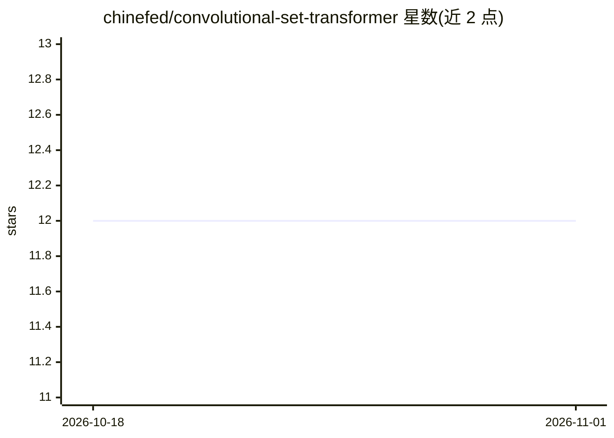

# chinefed/convolutional-set-transformer

⭐ 12 · Jupyter Notebook · MIT · 推送 2026-05-29 · [GitHub](https://github.com/chinefed/convolutional-set-transformer) · 个人维护

**卷积集合变换器的官方实现：图像集合分类与异常检测**

Chinello & Boracchi (2025) 论文的官方实现，以 cstmodels Python 包提供可复用的 Keras 3 层（SetConv2D、SmartReshape2D）用于构建 CST 架构，并开放 CST-15——首个在 ImageNet 上预训练的集合学习骨干模型。CST 处理任意基数的图像集合，支持集合分类与集合异常检测，兼容 Grad-CAM 等标准 CNN 可解释性工具，并支持迁移学习。面向使用 Keras 的研究者与开发者，从 PyPI 安装，附带两个教程 notebook（CIFAR-10 从零训练、结直肠组织病理学迁移学习）。

## 筛选速览

| 维度 | 判定 | 备注 |
|---|---|---|
| AI 角色 | `ai-native` | 本体是模型或模型工具 |
| 许可风险 | `permissive` | MIT |
| 部署形态 | `library` | 以包/库形式分发 |
| 模型依赖 | — | README 未给出锁定关系 |
| 硬件要求 | — | 无带数字的原话,不猜 |
| 安装摩擦 | `low` | 无编译、无系统依赖或容器化 |
| 成熟度 | — | 结构信号不足 |

## 能力要点

- CST-15：首个在 ImageNet 上预训练的集合学习骨干模型
- 处理任意基数图像集合，支持集合分类与集合异常检测
- 兼容 Grad-CAM 等标准 CNN 可解释性工具
- 提供 SetConv2D 与 SmartReshape2D 等 Keras 3 可复用层

## 适用场景

- 对图像集合做分类或异常检测（如医学影像集合）
- 用预训练 CST-15 骨干做迁移学习适配新任务
- 需要可解释性（Grad-CAM）的集合学习建模

## 场景标签

`目标检测` · 领域:感知与多模态

## 证据(README 行号)

> L3: The **cstmodels** package provides the reference implementation of the Convolutional Set Transformer (Chinello & Bor
> L15: - In the domain of image-set processing, CST **outperforms existing set-learning approaches** such as Deep Sets and

## 星数曲线

2026-10-18 12 → 2026-11-01 12（+0）

---
*卡片 v1 · prompt 1.4 · 生成 2026-11-01 · 置信度 high · 依据 README sha `d9ac97095a4e` · [字段定义](../../DATASET.md)*
