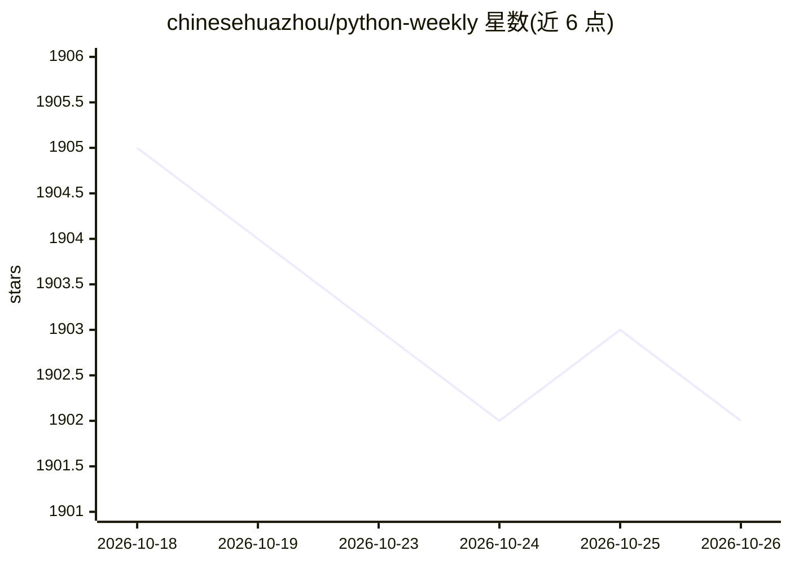

# chinesehuazhou/python-weekly

⭐ 1,902 · TypeScript · 推送 2026-10-25 · [GitHub](https://github.com/chinesehuazhou/python-weekly) · [官网](https://weekly.pythoncat.top) · 组织维护 · 中文 README

**Python 生态中英文内容策展周刊（付费订阅制）**

由 Python Cat 运营的周刊，从 400+ 中英文信息源筛选文章、教程、开源项目、软件工具、播客视频与热门话题，每期约 12 篇文章加 12 个开源项目，并附摘要与编者点评。制作流程采用 AI 聚合加人工筛选。已出版 171 期，累计收录 2071 篇文章与 1998 个项目；自第 47 期起转为付费订阅（Patreon），早期内容逐步免费开放（第 n+50 期）。通过官网、Telegram、微信等渠道分发。

## 筛选速览

| 维度 | 判定 | 备注 |
|---|---|---|
| AI 角色 | `ai-knowledge` | 知识聚合/清单类 |
| 许可风险 | `none` | — |
| 部署形态 | `library` | 以包/库形式分发 |
| 模型依赖 | — | README 未给出锁定关系 |
| 硬件要求 | — | 无带数字的原话,不猜 |
| 安装摩擦 | `medium` | 含编译或系统依赖之一 |
| 成熟度 | — | 结构信号不足 |

## 能力要点

- 从 400+ 中英文信息源筛选内容
- 每期约 12 篇文章加 12 个开源项目，附摘要与编者点评
- AI 聚合加人工编辑的筛选流程
- 已出版 171 期，累计 2071 篇文章与 1998 个项目

## 适用场景

- 跟踪 Python 生态的文章与开源项目动态
- 了解 Python 语言演进与社区热门话题
- 按期回溯查找往期精选资源

## 场景标签

`精选清单` · 领域:学习与行业

## 证据(README 行号)

> L18: Python Trending Weekly is produced by **Python Cat**, carefully curating over 400+ Chinese and English information 
> L36: Each issue features 12 carefully selected technical articles plus 12 open-source projects, enhanced with multimedia
> L40: AI technology efficiently aggregates massive information streams, while human editors apply rigorous standards to e

## 星数曲线

2026-10-18 1,905 → 2026-10-26 1,902（-3）

---
*卡片 v1 · prompt 1.4 · 生成 2026-10-21 · 置信度 mid · 依据 README sha `de041d69c1b7` · [字段定义](../../DATASET.md)*
