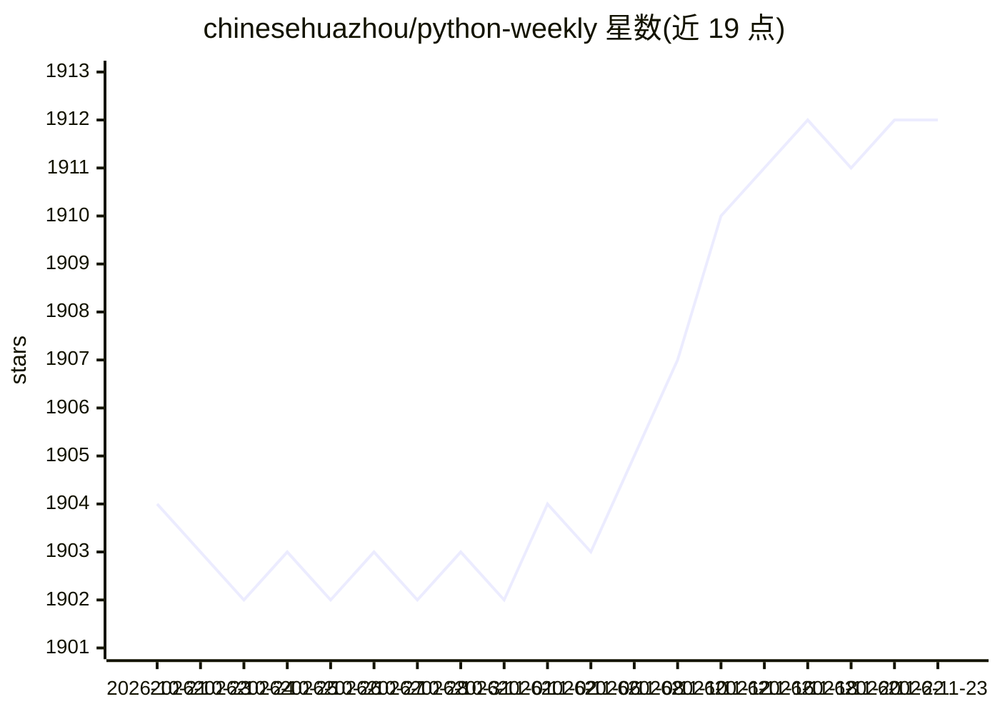

# chinesehuazhou/python-weekly

⭐ 1,912 · 推送 2026-11-18 · [GitHub](https://github.com/chinesehuazhou/python-weekly) · [官网](https://weekly.pythoncat.top) · 个人维护 · 中文 README

**面向 Python 开发者的中英文内容精选周刊**

由 Python Cat 制作的技术周刊，从 400+ 中英文信息源中筛选文章、教程、开源项目、播客视频与热门话题，每期含 12 篇技术文章与 12 个开源项目，并附编辑摘要与补充材料。累计 175 期，收录 2119 篇文章、2046 个项目。自第 47 期起转为付费订阅（Patreon），旧期内容随更新逐步免费开放，通过官网、Telegram、微信、Twitter 等渠道分发。

## 筛选速览

| 维度 | 判定 | 备注 |
|---|---|---|
| AI 角色 | `ai-knowledge` | 知识聚合/清单类 |
| 许可风险 | `none` | — |
| 部署形态 | `library` | 以包/库形式分发 |
| 模型依赖 | — | README 未给出锁定关系 |
| 硬件要求 | — | 无带数字的原话,不猜 |
| 安装摩擦 | `medium` | 含编译或系统依赖之一 |
| 成熟度 | — | 结构信号不足 |

## 能力要点

- 每期精选 12 篇文章与 12 个开源项目，附编辑摘要与补充材料
- 聚合 400+ 中英文信息源，双语发布
- 对 1000+ star 的开源项目做特殊标注
- 已发布 175 期，累计收录 2119 篇文章、2046 个项目

## 适用场景

- 每周追踪 Python 生态的文章、教程与新开源项目
- 了解 CPython、PEP、类型检查器等社区动态与热门话题
- 作为学习资料源提升 Python 技能

## 场景标签

`精选清单` · 领域:学习与行业

## 证据(README 行号)

> L18: Python Trending Weekly is produced by **Python Cat**, carefully curating over 400+ Chinese and English information 
> L38: ### 🤖 AI-Powered + Human-Curated
> L52: Starting from issue #47, this weekly newsletter has transitioned to a paid model. If you'd like to learn more about

## 星数曲线

2026-10-21 1,904 → 2026-11-23 1,912（+8）

---
*卡片 v1 · prompt 1.4 · 生成 2026-11-23 · 置信度 mid · 依据 README sha `b793f95079e3` · [字段定义](../../DATASET.md)*
