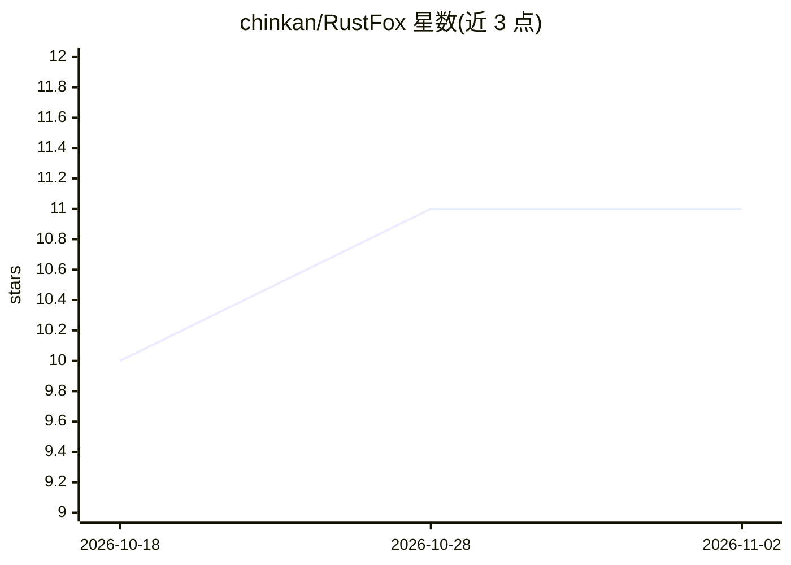

# chinkan/RustFox

⭐ 11 · Rust · MIT · 推送 2026-11-01 · [GitHub](https://github.com/chinkan/RustFox) · 个人维护

**自托管的 Telegram AI 助手：Rust 单二进制，带沙箱工具与记忆**

用 Rust 编写的开源自托管 Telegram AI 助手，面向想在自己服务器上运行 agentic 助手的用户。接收消息后调用沙箱化工具（文件读写、命令执行、经 MCP 的网页搜索）循环执行直至完成；通过 SQLite 与向量 RAG（FTS5 混合检索）持久化记忆，支持技能与子代理、多 bot 多人格、cron/一次性任务调度，并内置 Web 门户。LLM 提供方无绑定：默认 OpenRouter，可选本地 Ollama 或任意 OpenAI 兼容端点，带模型回退链。以单二进制发布，提供安装向导，可注册为 systemd/launchd 服务；Windows 发布二进制未签名，SAC 开启时会被阻止。

## 筛选速览

| 维度 | 判定 | 备注 |
|---|---|---|
| AI 角色 | `ai-native` | 本体是模型或模型工具 |
| 许可风险 | `permissive` | MIT |
| 部署形态 | `desktop` | 安装包/桌面程序 |
| 模型依赖 | local-ok | 支持本地模型 |
| 硬件要求 | — | 无带数字的原话,不猜 |
| 安装摩擦 | `medium` | 含编译或系统依赖之一 |
| 成熟度 | — | 结构信号不足 |

## 能力要点

- 沙箱化内置工具：文件 I/O、命令执行、任务调度、MCP 服务器接入
- SQLite + 向量 RAG 持久记忆（FTS5 混合检索）与技能/子代理体系
- 多提供方 LLM：OpenRouter、本地 Ollama、OpenAI 兼容端点，运行时切模型与回退链
- 单进程运行多个 Telegram bot，各自绑定人格、模型与工具白名单

## 适用场景

- 在 Telegram 里通过对话让 AI 代为处理文件、执行命令和定时任务
- 自托管一个有长期记忆和子代理的私人 AI 助手
- 在一个进程里运行多个不同人格的 Telegram bot

## 场景标签

`AI 助手` `Agent 记忆` · 领域:Agent 开发

## 证据(README 行号)

> L13: An open-source, self-hosted Telegram AI assistant written in Rust. It solves a simple problem: most AI assistants a
> L17: Drop a file, ask a question, schedule a task — RustFox handles it. The default path is OpenRouter. Ollama is the lo
> L29: |🤖 **AI Agent**|Multi-provider LLM (OpenRouter, local Ollama, any OpenAI-compatible endpoint), agentic loop with to

## 星数曲线

2026-10-18 10 → 2026-11-02 11（+1）

---
*卡片 v1 · prompt 1.4 · 生成 2026-11-02 · 置信度 high · 依据 README sha `cac777f24876` · [字段定义](../../DATASET.md)*
