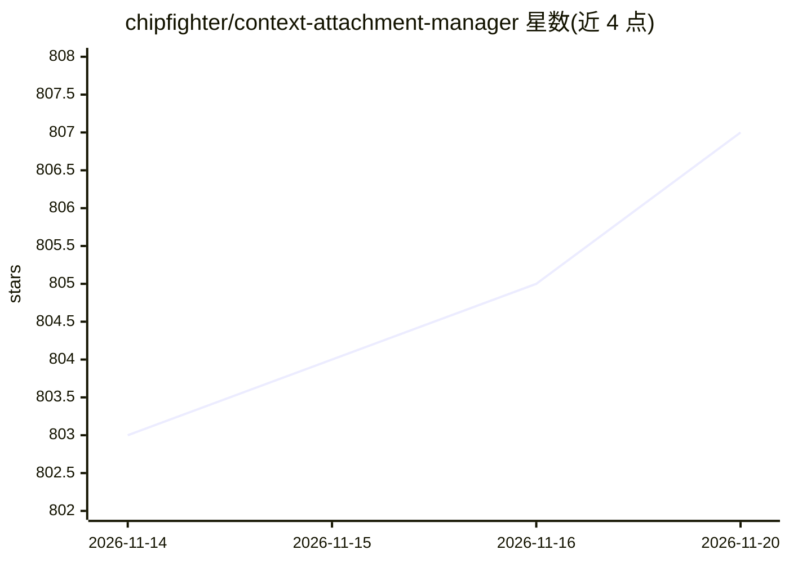

# chipfighter/context-attachment-manager

⭐ 807 · TypeScript · MIT · 推送 2026-11-19 · [GitHub](https://github.com/chipfighter/context-attachment-manager) · 组织维护 · 中文 README

**本地插件：让编码 agent 旧图变占位符、按 ID 取回原图并保住缓存**

面向 Codex、Claude Code 等编码 agent 的本地插件，解决多图长对话请求体积膨胀问题：为每张图片编号（IMG-001…），此前的图片以短占位符随消息发送，模型需要时按 ID 在当前轮末尾取回原图（compaction 后仍可），占位符写定后不变以保持 prompt cache 命中。提供控制面板（搜索、手动选图、Send every turn），本地运行，图片与聊天记录不外传。Codex 与 Claude Code 经测试，另 11 种 agent 通过适配器支持但未实测。MIT 许可，跨平台。

## 筛选速览

| 维度 | 判定 | 备注 |
|---|---|---|
| AI 角色 | `ai-ecosystem` | LLM/agent 周边工具 |
| 许可风险 | `permissive` | MIT |
| 部署形态 | `None` |  |
| 模型依赖 | — | README 未给出锁定关系 |
| 硬件要求 | — | 无带数字的原话,不猜 |
| 安装摩擦 | `low` | 无编译、无系统依赖或容器化 |
| 成熟度 | `idea` | |

## 能力要点

- 旧图替换为带编号与描述的占位符，模型按 ID 取回原图
- 占位符只写一次、取回加在当前轮末尾，保持 prompt cache 命中
- 控制面板支持按细节/备注搜图、手动选图与强制每轮发送
- Codex 实测：九帧对话请求从 42.4 MB 降至 0.12 MB

## 适用场景

- 在编码 agent 里做多图/视频生成、扫描文档、浏览器使用的长对话
- 减少多图长聊的请求体积，避免消息发不出去
- 在压缩（compaction）后仍能找回并查看早期图片

## 场景标签

`Agent 记忆` · 领域:Agent 开发

## 证据(README 行号)

> L3:  A local plugin for image-heavy chats in Codex, Claude Code and other agents. Earlier images stop going out with eve
> L15: An agent normally sends every earlier image again with each message, so a long chat with many images gets slow and 

## 星数曲线

2026-11-14 803 → 2026-11-20 807（+4）

---
*卡片 v1 · prompt 1.4 · 生成 2026-11-17 · 置信度 high · 依据 README sha `917e185d92f8` · [字段定义](../../DATASET.md)*
