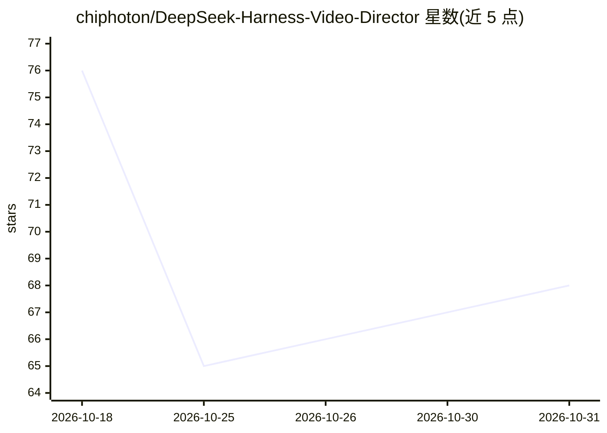

# chiphoton/DeepSeek-Harness-Video-Director

⭐ 68 · JavaScript · MIT · 推送 2026-09-28 · [GitHub](https://github.com/chiphoton/DeepSeek-Harness-Video-Director) · 个人维护 · 中文 README

**DeepSeek Harness 的可视化视频生产插件：画布式编排多源生成**

构建于 DeepSeek Harness 之上的视频生产插件，把脚本、提示词、图像、音频与视频生成组织为无限画布上的节点图（vd-workflow）。初学者可使用内置工作流，不必手工拼装各提供方调用；支持在同一项目中混用 Ollama、OpenAI 兼容端点、Codex Plan 与一个 ComfyUI 后端，含 Qwen3.8-27B 与 MiniMax-H3 的本地管线。需要已安装的 dsh CLI，通过 git clone + pnpm 构建后以插件形式装入；不自动安装模型或外部服务，媒体编辑功能需 ffmpeg。

## 筛选速览

| 维度 | 判定 | 备注 |
|---|---|---|
| AI 角色 | `ai-ecosystem` | LLM/agent 周边工具 |
| 许可风险 | `permissive` | MIT |
| 部署形态 | `library` | 以包/库形式分发 |
| 模型依赖 | local-ok | 支持本地模型 |
| 硬件要求 | — | 无带数字的原话,不猜 |
| 安装摩擦 | `medium` | 含编译或系统依赖之一 |
| 成熟度 | — | 结构信号不足 |

## 能力要点

- 画布式节点图连接文本/图像/音频/视频生成与输出
- 同一项目混用 Ollama、OpenAI 兼容端点、Codex Plan 与 ComfyUI 后端
- 内置图像、H3 视频、H3 音频与提示增强等开箱工作流
- 跨浏览器标签共享工作流队列，主机重启后排队能力恢复

## 适用场景

- 在本地用 Ollama + ComfyUI 搭建全本地的图像/视频/音频生产管线
- 不写代码，通过画布和内置工作流生成 MiniMax-H3 视频与音频
- 在多个生成提供方之间按节点切换模型完成多阶段媒体创作

## 场景标签

`视频生成` `图像生成` `工作流自动化` · 领域:效率与自动化

## 证据(README 行号)

> L17: DeepSeek-Harness Video-Director is a video-production plugin built for DeepSeek Harness. It turns script, image, au
> L12:  A visual, node-based video director for DeepSeek Harness.

## 星数曲线

2026-10-18 76 → 2026-10-31 68（-8）

---
*卡片 v1 · prompt 1.4 · 生成 2026-10-24 · 置信度 mid · 依据 README sha `22a3ff73b689` · [字段定义](../../DATASET.md)*
