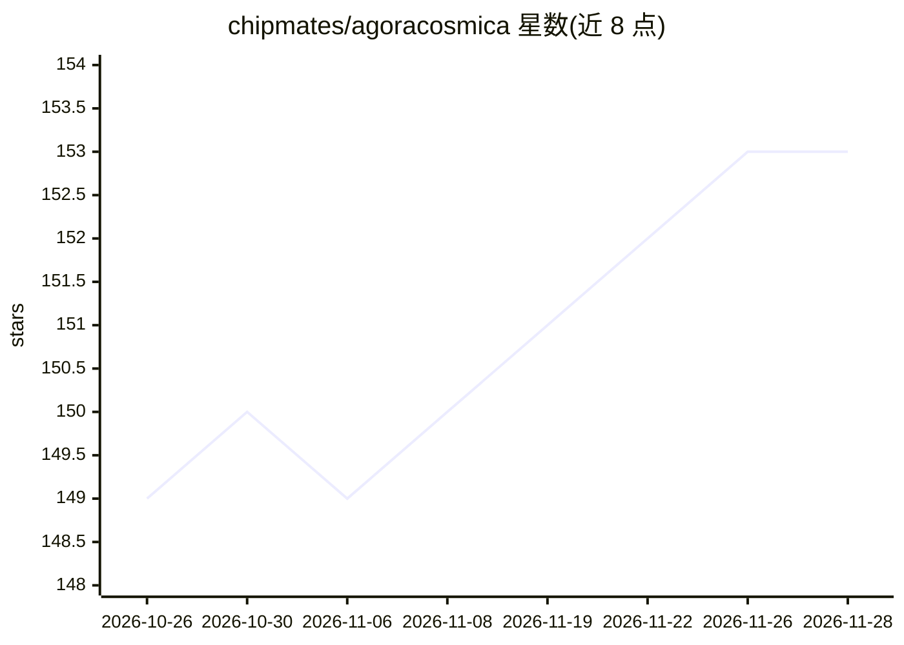

# chipmates/agoracosmica

⭐ 153 · TypeScript · AGPL-3.0 · 推送 2026-11-27 · [GitHub](https://github.com/chipmates/agoracosmica) · [官网](https://agoracosmica.org)

**面向学习者：可对话的30位历史人物语音故事图书馆（英/德）**

非营利开源的数字人文应用：30位历史人物、每人12章语音旁白生活故事（共360章，英语79小时/德语86小时），提供故事、Wisdom对话、Prism、Quest、Free Talk、Council六种格式。AI Echo 回答基于原始著作与历史语境，应用全程标注为AI生成，每章配 factcheck 区分史实与虚构。聊天功能已于2026年10月停止，代码保留待移除。支持 BYOK（OpenRouter）与本地 OpenAI 兼容端点；数据存于浏览器 IndexedDB 并以 AES-256-GCM 加密；界面目标 WCAG 2.2 AA。

## 筛选速览

| 维度 | 判定 | 备注 |
|---|---|---|
| AI 角色 | `ai-native` | 本体是模型或模型工具 |
| 许可风险 | `viral` | AGPL-3.0 |
| 部署形态 | `self-host` | docker 或自建部署 |
| 模型依赖 | local-ok | 支持本地模型 |
| 硬件要求 | — | 无带数字的原话,不猜 |
| 安装摩擦 | `low` | 无编译、无系统依赖或容器化 |
| 成熟度 | — | 结构信号不足 |

## 能力要点

- 30位历史人物、360章语音故事，英德双语，附 factcheck 史实/虚构分离面板
- 支持自备 OpenRouter key 或指向任意 OpenAI 兼容本地端点（LM Studio/Ollama/vLLM/llama.cpp）
- 浏览器端 AES-256-GCM 加密存储，无账号、无追踪 cookie，免费额度经 Cloudflare Worker 转发
- 目标 WCAG 2.2 AA：键盘路径、屏幕阅读器标签、44px 触控目标

## 适用场景

- 在课堂中使用带 factcheck 的历史人物章节与教学
- 本地运行模型，让对话数据不出本机
- 以无障碍方式收听历史人物生平故事

## 场景标签

 · 领域:教育/数字人文

## 证据(README 行号)

> L27: The figures run from Laozi to Martin Luther King Jr. The voice that answers is an AI Echo, an interpretation ground
> L121: The app on port 8080, with Kokoro for English speech and Whisper for transcription beside it. `--profile nvidia` a

## 星数曲线

2026-10-26 149 → 2026-11-28 153（+4）

---
*卡片 v1 · prompt 1.4 · 生成 2026-11-27 · 置信度 mid · 依据 README sha `fcf5c2df3b08` · [字段定义](../../DATASET.md)*
