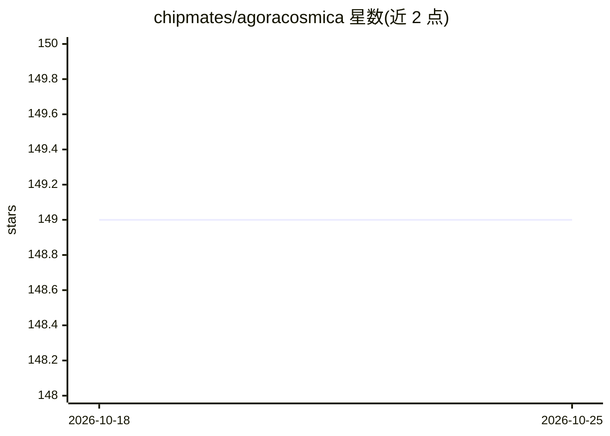

# chipmates/agoracosmica

⭐ 149 · TypeScript · AGPL-3.0 · 推送 2026-10-23 · [GitHub](https://github.com/chipmates/agoracosmica) · [官网](https://agoracosmica.org) · 组织维护

**可与三十位历史人物对话的“活图书馆”Web应用**

面向教育与人文学科读者的非营利开源 Web 应用：三十位历史人物各含十二章有声生平故事、十二条教义对话及一个可实时问答的 AI Echo 回声角色，提供英德双语。免费层经 Cloudflare Worker 调用 Nebius 上的 DeepSeek V4 Pro（Qwen3-235B 兜底），也可用自有 OpenRouter key 或本地 OpenAI 兼容端点（LM Studio/Ollama/vLLM/llama.cpp）；语音用 Qwen3-TTS/faster-whisper。每章附事实核查面板区分史实与创作，接口按 WCAG 2.2 AA 设计，数据仅存浏览器 IndexedDB（AES-256-GCM 加密）。支持 Docker 自托管，内容受单独许可保护暂不可再分发。

## 筛选速览

| 维度 | 判定 | 备注 |
|---|---|---|
| AI 角色 | `ai-native` | 本体是模型或模型工具 |
| 许可风险 | `viral` | AGPL-3.0 |
| 部署形态 | `self-host` | docker 或自建部署 |
| 模型依赖 | — | README 未给出锁定关系 |
| 硬件要求 | — | 无带数字的原话,不猜 |
| 安装摩擦 | `low` | 无编译、无系统依赖或容器化 |
| 成熟度 | — | 结构信号不足 |

## 能力要点

- 三十位历史人物 × 六种内容形式，含 360 章有声故事与实时 AI Echo 对话
- 每章事实核查面板区分 documented/recreated 并附来源
- BYOK：OpenRouter key 或任意 OpenAI 兼容本地端点，浏览器直连不经服务器
- 自伤内容分级筛查、越狱模式拦截、X-AI-Generated 响应头标注 AI 身份

## 适用场景

- 边听人物生平边向其 AI 回声提问的学习体验
- 课堂教学中使用带来源事实核查的历史章节
- 通过 Docker 自托管并接入本地模型，数据留在本机

## 场景标签

`聊天机器人` `语音合成` `语音识别` · 领域:对话与助手

## 证据(README 行号)

> L19: Thirty figures across 2,500 years. Each has twelve narrated chapters of their life, twelve teachings to talk throug
> L25: The figures run from Laozi to Martin Luther King Jr. The voice that answers is an AI Echo, an interpretation ground
> L77: The free tier is 30 messages a day per device. They pass through a Cloudflare Worker to DeepSeek V4 Pro at Nebius i

## 星数曲线

2026-10-18 149 → 2026-10-25 149（+0）

---
*卡片 v1 · prompt 1.4 · 生成 2026-10-23 · 置信度 mid · 依据 README sha `f0cf7c33c210` · [字段定义](../../DATASET.md)*
