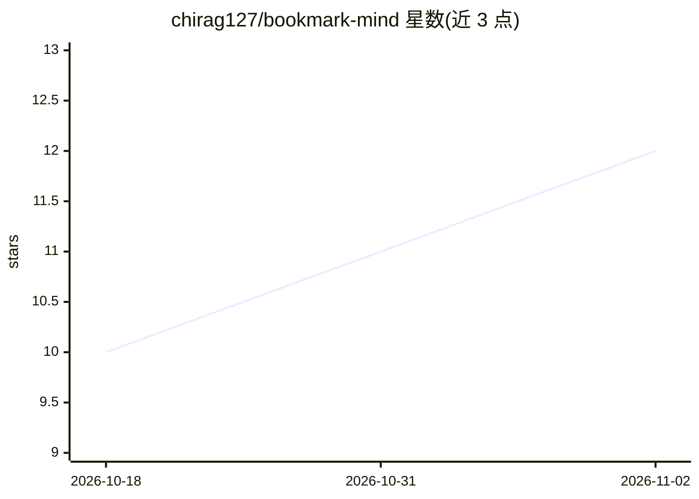

# chirag127/bookmark-mind

⭐ 12 · JavaScript · MIT · 推送 2026-08-19 · [GitHub](https://github.com/chirag127/bookmark-mind) · [官网](https://bookmark-mind.oriz.in) · 个人维护

**用自带 LLM key 自动整理浏览器书签的 MV3 扩展**

Manifest V3 Chrome 扩展，读取 chrome.bookmarks 树，经批处理管线调用用户配置的 OpenAI 兼容 LLM，把书签归类为按功能组织的文件夹树（如 Tools > File Tools > Cloud Storage）。内置 13 个 provider 预设（Groq、OpenRouter、Gemini、DeepSeek、OpenAI 及 LM Studio/Ollama/LiteLLM 等本地端点），也支持任意自定义 HTTPS 端点。API key 以 AES-256-GCM 加密后存入 chrome.storage.sync，支持 provider 拖拽排序与限流后备。无服务器、无遥测，书签数据仅在点击分类时发往所配置的 provider。Chrome Web Store 上架待审，当前需从源码以 Load unpacked 方式安装。

## 筛选速览

| 维度 | 判定 | 备注 |
|---|---|---|
| AI 角色 | `ai-native` | 本体是模型或模型工具 |
| 许可风险 | `permissive` | MIT |
| 部署形态 | `library` | 以包/库形式分发 |
| 模型依赖 | local-ok | 支持本地模型 |
| 硬件要求 | — | 无带数字的原话,不猜 |
| 安装摩擦 | `low` | 无编译、无系统依赖或容器化 |
| 成熟度 | — | 结构信号不足 |

## 能力要点

- 13 个内置 OpenAI 兼容 provider + 任意自定义端点统一适配
- API key AES-256-GCM 加密存储，无服务器无遥测
- provider 拖拽排序与 429 限流 5 分钟冷却后备
- 按服务功能（FMHY 风格）而非品牌归类文件夹

## 适用场景

- 把多年堆积的书签一键整理成功能化文件夹树
- 用本地 Ollama/LM Studio 或免费档云端模型，不花额外费用整理书签
- 自带 API key，不让第三方服务器经手我的链接数据

## 场景标签

 · 领域:浏览器扩展/生产力工具

## 证据(README 行号)

> L13: Browser bookmarks rot into a giant unsorted heap. Manual foldering is tedious, and cloud "smart" organizers want yo
> L35: - **13 built-in providers** — Groq, Cerebras, Google Gemini, OpenRouter, Mistral, HuggingFace, DeepSeek, OpenAI, No

## 星数曲线

2026-10-18 10 → 2026-11-02 12（+2）

---
*卡片 v1 · prompt 1.4 · 生成 2026-11-02 · 置信度 mid · 依据 README sha `6eb4e79b070e` · [字段定义](../../DATASET.md)*
