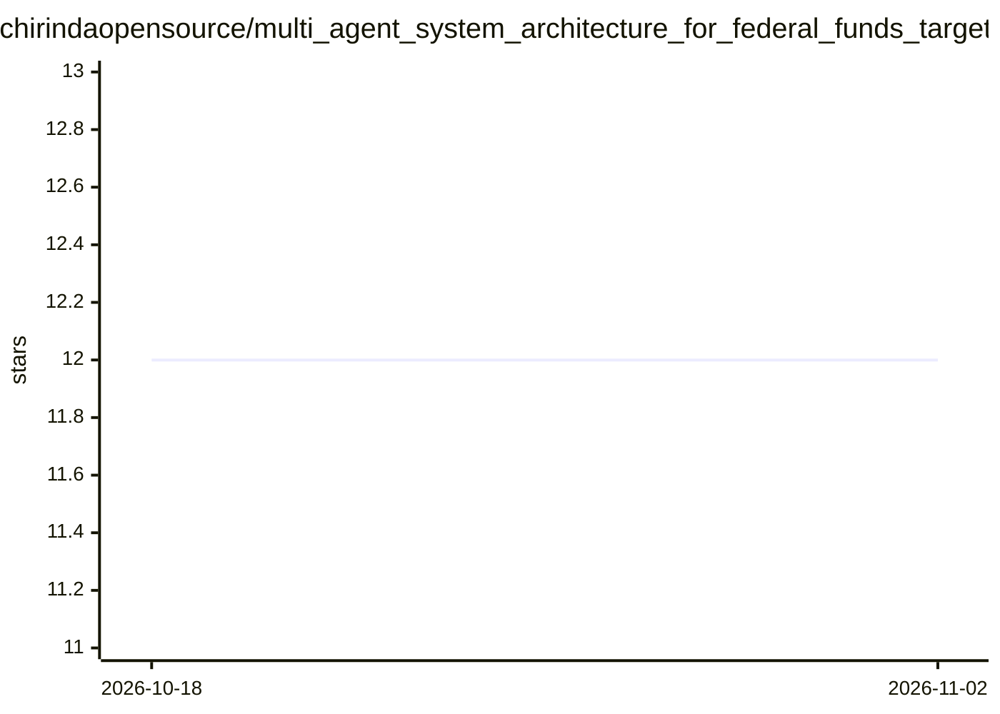

# chirindaopensource/multi_agent_system_architecture_for_federal_funds_target_rate_prediction

⭐ 12 · Jupyter Notebook · MIT · 推送 2026-01-03 · [GitHub](https://github.com/chirindaopensource/multi_agent_system_architecture_for_federal_funds_target_rate_prediction) · 个人维护

**复现 FedSight AI 论文：LLM 多智能体预测美联储联邦基金目标利率**

对 Hou 等 2025 年论文《FedSight AI》的独立 Python 复现实现，以单个 iPython Notebook 提供 30 个模块化任务组成的端到端流水线：清洗宏观指标与非结构化文本（Beige Book、Dot Plot），按信息截止规则构建会议数据包，用 CrewAI 模拟 FOMC 审议（Analyst/Economist/Member 角色），实现 Chain-of-Draft 推理与 In-Context Learning 记忆注入，输出利率预测并计算 Accuracy、Stability、语义相似度等指标。运行需 Python 3.9+ 与 openai、crewai 等依赖，全部参数经 config.yaml 配置。

## 筛选速览

| 维度 | 判定 | 备注 |
|---|---|---|
| AI 角色 | `ai-native` | 本体是模型或模型工具 |
| 许可风险 | `permissive` | MIT |
| 部署形态 | `library` | 以包/库形式分发 |
| 模型依赖 | — | README 未给出锁定关系 |
| 硬件要求 | — | 无带数字的原话,不猜 |
| 安装摩擦 | `low` | 无编译、无系统依赖或容器化 |
| 成熟度 | — | 结构信号不足 |

## 能力要点

- 以多智能体（Analyst/Economist/Members）模拟 FOMC 审议并投票产出利率预测
- Chain-of-Draft 推理协议与基于向量记忆的 In-Context Learning
- K-Means 对历史 FOMC 参与者聚类生成成员原型
- 单一 execute_full_study_lifecycle 函数复现全流程，SQLite 持久化并记录来源

## 适用场景

- 复现 FedSight AI 论文实验结果
- 研究生成式多智能体方法在货币政策预测中的应用
- 基于 config.yaml 调整 LLM 与仿真参数做扩展实验

## 场景标签

`多智能体` `金融量化` · 领域:Agent 开发

## 证据(README 行号)

> L55: - Simulate FOMC deliberations using a multi-agent system (MAS) with distinct roles (Analyst, Economist, Members).
> L56: - Implement advanced reasoning protocols including Chain-of-Draft (CoD) and In-Context Learning (ICL).

## 星数曲线

2026-10-18 12 → 2026-11-02 12（+0）

---
*卡片 v1 · prompt 1.4 · 生成 2026-11-01 · 置信度 mid · 依据 README sha `1707088f5601` · [字段定义](../../DATASET.md)*
