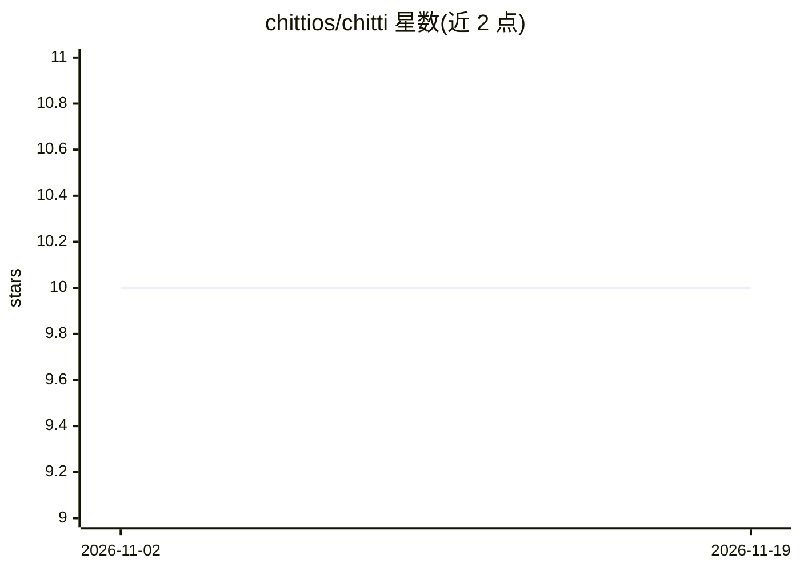

# chittios/chitti

⭐ 10 · Rust · Apache-2.0 · 推送 2026-08-23 · [GitHub](https://github.com/chittios/chitti) · [官网](https://chittios.com) · 个人维护

**以 AI agent 为基本执行单元的裸金属操作系统**

Chitti 是一个从零构建的 x86_64/aarch64 裸金属操作系统：基本执行单元是 AI agent 而非二进制进程，无 POSIX/libc/ELF loader/shell。小型语言模型经 GGUF 加载器在 CPU 上裸机推理，模型输出作为不可信计划，经 grammar 约束、能力检查与审计日志的 ABI（Synapse）由确定性执行器落地。shell 即 agent，支持子 agent 委派、权限门控、MCP 客户端、技能与 agent 包的公共注册表安装。README 明确标注为不稳定的研究型系统，建议在 VM 中运行。

## 筛选速览

| 维度 | 判定 | 备注 |
|---|---|---|
| AI 角色 | `ai-ecosystem` | LLM/agent 周边工具 |
| 许可风险 | `permissive` | Apache-2.0 |
| 部署形态 | `None` |  |
| 模型依赖 | local-ok | 支持本地模型 |
| 硬件要求 | `cpu-ok` | |
| 安装摩擦 | `low` | 无编译、无系统依赖或容器化 |
| 成熟度 | `idea` | |

## 能力要点

- agent 为基本执行单元：spawn(agent) → plan → 确定性执行器运行原语
- CPU-only 裸机推理：GGUF 加载器、GGML 量化、手写 SIMD 张量内核（SSE2/AVX2/NEON）
- Synapse 能力 ABI：grammar 约束、MCP 形态工具调用、作用域/污点门控与审计日志
- 内核内置浏览器、H.264/H.265 视频播放、PDF 渲染与 Telegram 消息通道

## 适用场景

- 在 VM 中体验以 agent 为核心的操作系统原型
- 研究 OS 边界上的提示注入防御与能力沙箱机制
- 通过 Telegram 远程与机器上的 shell agent 交互
- 在 Apple Silicon（Mac mini M2）上裸机启动实验

## 场景标签

 · 领域:操作系统/系统软件

## 证据(README 行号)

> L12: Chitti is a bare-metal OS (x86_64 and aarch64) whose fundamental unit of
> L13: execution is an **AI agent**, not a compiled binary. There is no
> L17: spawn(agent) → plan over capabilities → a deterministic executor runs the primitives

## 星数曲线

2026-11-02 10 → 2026-11-19 10（+0）

---
*卡片 v1 · prompt 1.4 · 生成 2026-11-19 · 置信度 high · 依据 README sha `151ae46dcda2` · [字段定义](../../DATASET.md)*
