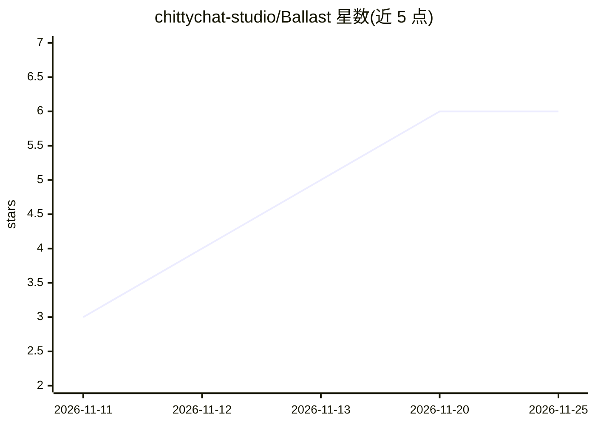

# chittychat-studio/Ballast

⭐ 6 · HTML · Apache-2.0 · 推送 2026-11-10 · [GitHub](https://github.com/chittychat-studio/Ballast) · [官网](https://github.com/chittychat-studio/Ballast#readme) · 个人维护

**让 AI 编码代理按指令清理 AI 工具遗留的磁盘与显存占用**

Ballast 本体是一组 Markdown 指令文件，由用户自己的 AI 编码代理读取并执行：只读扫描 AI 工具遗留的文件与 GPU/内存占用，按 Green/Yellow/Grey/Red 四级分类，删除前逐项征求用户批准，删除仅进回收站并记录日志。无需安装程序；提供 Claude Code/Codex 插件两种入口或直接 clone 后让任意代理读取 AGENTS.md。声明当前仅在 Windows 11 一台真实机器上验证，macOS/Linux 目录条目均标记 planned。Apache 2.0 许可。

## 筛选速览

| 维度 | 判定 | 备注 |
|---|---|---|
| AI 角色 | `ai-native` | 本体是模型或模型工具 |
| 许可风险 | `permissive` | Apache-2.0 |
| 部署形态 | `None` |  |
| 模型依赖 | — | README 未给出锁定关系 |
| 硬件要求 | — | 无带数字的原话,不猜 |
| 安装摩擦 | `low` | 无编译、无系统依赖或容器化 |
| 成熟度 | `idea` | |

## 能力要点

- 只读扫描先行，每次删除前逐项请求用户批准
- Green/Yellow/Grey/Red 四级分类与个人文件/凭据保护清单
- 静态 HTML 仪表盘（纯浏览器本地运行，不联网）
- 支持 Claude Code/Codex 插件安装及任意能读文件执行命令的代理

## 适用场景

- 磁盘空间不足时找出各 AI 工具留下的缓存与项目文件
- 排查本地模型进程占用的显存与孤儿进程
- 按周例行检查 AI 工具遗留文件的增量

## 场景标签

 · 领域:系统维护/AI 工具配套

## 证据(README 行号)

> L5: Ballast is a set of plain-text instructions that your AI coding agent follows to find and clear the disk and memory
> L14: you run. Your own agent reads the instructions, runs
> L15: read-only checks through its own tools, and **asks you before every deletion**.

## 星数曲线

2026-11-11 3 → 2026-11-25 6（+3）

---
*卡片 v1 · prompt 1.4 · 生成 2026-11-20 · 置信度 mid · 依据 README sha `49e60d474db5` · [字段定义](../../DATASET.md)*
