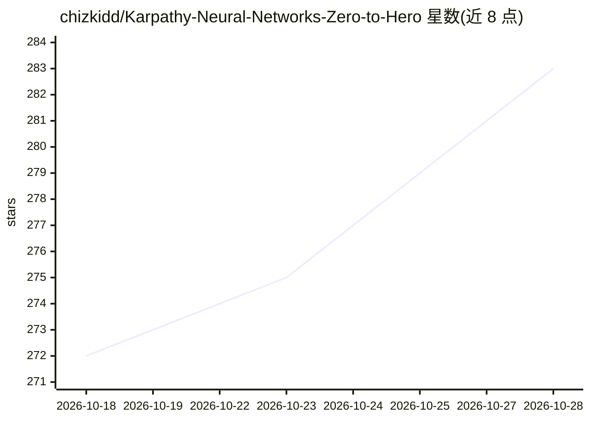

# chizkidd/Karpathy-Neural-Networks-Zero-to-Hero

⭐ 283 · Jupyter Notebook · MIT · 推送 2026-10-03 · [GitHub](https://github.com/chizkidd/Karpathy-Neural-Networks-Zero-to-Hero) · [官网](https://chizkidd.github.io/Karpathy-Neural-Networks-Zero-to-Hero/) · 个人维护

**Karpathy《Neural Networks: Zero to Hero》课程的笔记与代码实现**

对 Andrej Karpathy 的 YouTube 课程《Neural Networks: Zero to Hero》的讲义与练习所做的详细 Python 实现，以 Jupyter Notebook 形式提供，路径从反向传播基础、多层感知机、卷积神经网络推进到 GPT，并涵盖分词、字节对编码（BPE）及从零构建 tokenizer 与 GPT-2。领域聚焦语言建模，并介绍理解网络动态与性能的诊断工具。仓库标注仍在持续更新中，MIT 许可但要求注明原作者归属。

## 筛选速览

| 维度 | 判定 | 备注 |
|---|---|---|
| AI 角色 | `ai-knowledge` | 知识聚合/清单类 |
| 许可风险 | `permissive` | MIT |
| 部署形态 | `None` |  |
| 模型依赖 | — | README 未给出锁定关系 |
| 硬件要求 | — | 无带数字的原话,不猜 |
| 安装摩擦 | `low` | 无编译、无系统依赖或容器化 |
| 成熟度 | — | 结构信号不足 |

## 能力要点

- 覆盖 micrograd、makemore、GPT、minBPE、GPT-2 等模块的笔记与练习
- 从反向传播到 GPT-2 与 BPE tokenizer 的从零实现路径
- 附带神经网络诊断工具的介绍

## 适用场景

- 跟随课程系统学习从零构建神经网络的原理与代码
- 通过练习巩固深度学习基础概念
- 参考 BPE tokenizer 与 GPT-2 的实现细节

## 场景标签

`教程课程` · 领域:学习与行业

## 证据(README 行号)

> L7: This repository contains my detailed implementations of Andrej Karpathy's Neural Networks: Zero to Hero youtube lect
> L25: Still Ongoing...

## 星数曲线

2026-10-18 272 → 2026-10-28 283（+11）

---
*卡片 v1 · prompt 1.4 · 生成 2026-10-22 · 置信度 high · 依据 README sha `89a175a19722` · [字段定义](../../DATASET.md)*
