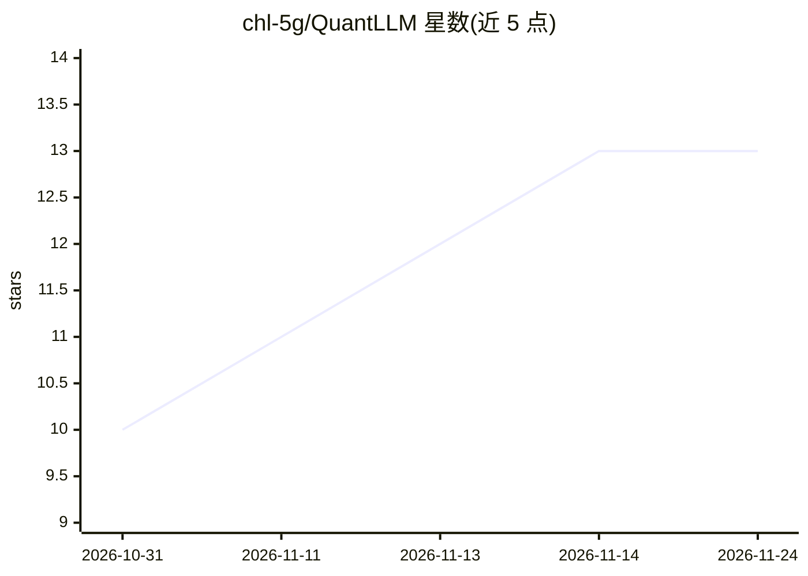

# chl-5g/QuantLLM

⭐ 13 · Python · 推送 2026-09-21 · [GitHub](https://github.com/chl-5g/QuantLLM) · 个人维护 · 中文 README

**基于微调 LLM 的 A 股量化多 Agent 交易研究系统**

基于 Qwen3.8-27B QLoRA 微调与 LangGraph 多 Agent 工作流的 A 股量化交易系统，参考 ai-hedge-fund 多分析师架构，覆盖 A 股、商品期货、ETF、可转债。技术面、基本面、资金面、情绪面、估值、市场环境 6 类分析师并行输出信号，经风控层与组合经理生成 buy/sell/hold 决策，最终由 TypeSafe Jev 结构化裁决、生成式模型兜底。含 28 个技术指标库、走步验证回测与东方财富模拟盘接入，声明仅供研究与教育用途。

## 筛选速览

| 维度 | 判定 | 备注 |
|---|---|---|
| AI 角色 | `ai-native` | 本体是模型或模型工具 |
| 许可风险 | `none` | — |
| 部署形态 | `library` | 以包/库形式分发 |
| 模型依赖 | local-ok | 支持本地模型 |
| 硬件要求 | `gpu-24g` | |
| 安装摩擦 | `medium` | 含编译或系统依赖之一 |
| 成熟度 | — | 结构信号不足 |

## 能力要点

- 6 类分析师 Agent 并行，A股反转效应策略（技术因子 IC 为负）
- QLoRA 4bit 微调流水线：数据采集→转换→合并→训练一键执行
- Jev 结构化决策裁决，Qwen 生成式与规则 hold 双层兜底
- 接入东方财富模拟盘，每 5 分钟一轮调度执行

## 适用场景

- 研究 A 股多 Agent 量化决策与回测流程
- 在本地 GPU 上对 Qwen 基座做 QLoRA 金融微调
- 接入东方财富模拟盘演练自动化交易流程

## 场景标签

`多智能体` `金融量化` `微调` · 领域:Agent 开发

## 证据(README 行号)

> L5: 基于 Qwen3.8-27B 微调 + LangGraph 多 Agent 工作流的 A 股量化交易系统。参考 ai-hedge-fund 的多分析师协作架构，结合 A 股特有的反转效应（全技术因子 IC 为负）和市场环境感知，覆盖
> L100: ## 多 Agent 系统详解
> L123: start → [6个分析师并行] → 风控管理 → 组合经理 → 最终决策

## 星数曲线

2026-10-31 10 → 2026-11-24 13（+3）

---
*卡片 v1 · prompt 1.4 · 生成 2026-11-18 · 置信度 high · 依据 README sha `342f17e7668b` · [字段定义](../../DATASET.md)*
