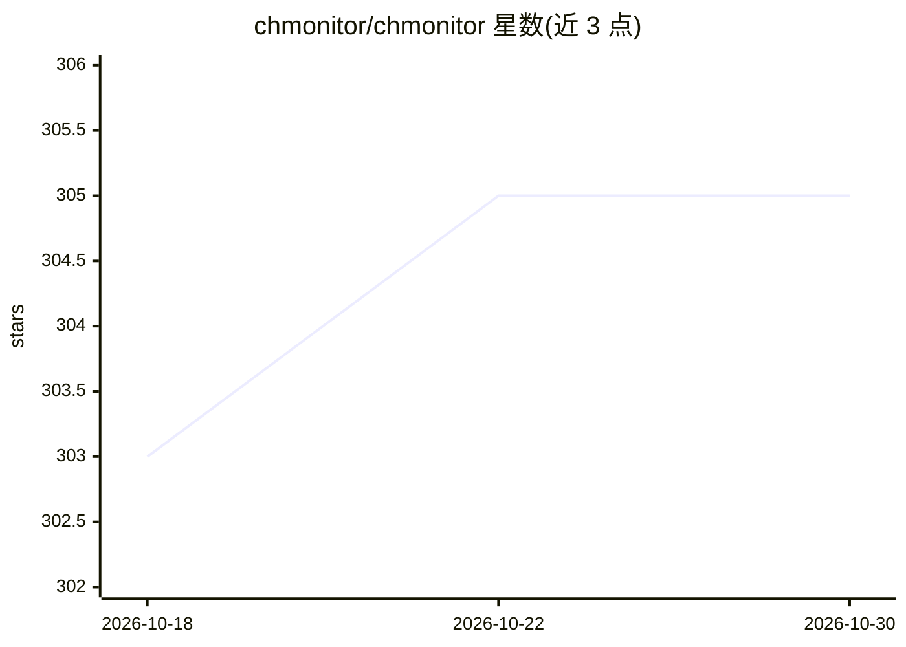

# chmonitor/chmonitor

⭐ 305 · TypeScript · GPL-3.0 · 推送 2026-10-29 · [GitHub](https://github.com/chmonitor/chmonitor) · [官网](https://chmonitor.dev) · 个人维护

**ClickHouse 运维监控面板，附 AI 优化建议与 AI 问答**

面向 ClickHouse 的自托管监控与运维顾问：读取 system.* 表展示查询、合并、副本、存储与健康状态，提供 30+ 图表、集群拓扑、只读 SQL 控制台与 chm CLI（含 TUI 和 chm doctor）。AI 部分为内置 agent：给出 projections、skip indexes、PREWHERE、物化视图等建议（不自动执行 DDL），并支持 MCP 供 Claude/Cursor 调用，可用英文询问 schema、存储与健康状况。以 Docker 单容器交付，可部署到 K8s、Cloudflare Workers、Railway 等，支持 ClickHouse Cloud。GPL-3.0 下全功能免费，另售可选商业许可（不含额外功能）。

## 筛选速览

| 维度 | 判定 | 备注 |
|---|---|---|
| AI 角色 | `ai-enhanced` | 去掉 AI 部分产品仍成立 |
| 许可风险 | `dual` | GPL-3.0 |
| 部署形态 | `desktop` | 安装包/桌面程序 |
| 模型依赖 | — | README 未给出锁定关系 |
| 硬件要求 | — | 无带数字的原话,不猜 |
| 安装摩擦 | `low` | 无编译、无系统依赖或容器化 |
| 成熟度 | — | 结构信号不足 |

## 能力要点

- 读取 system.* 表呈现集群查询/合并/副本/存储/健康状态，30+ 图表
- AI advisor 输出 projections/skip indexes/PREWHERE/MV 建议，不执行 DDL
- 内置 AI agent 并提供 MCP 接入 Claude/Cursor
- chm CLI 提供 live TUI 与 chm doctor 检查

## 适用场景

- 自托管监控多个 ClickHouse 主机的运行状况
- 让 AI 给出索引、分区与物化视图优化建议
- 在 Claude/Cursor 中通过 MCP 查询 ClickHouse 运维状态

## 场景标签

`AI 助手` · 领域:对话与助手

## 证据(README 行号)

> L22: **chmonitor** is a dashboard and advisor for ClickHouse. It reads `system.*`
> L42: |Get a second opinion|AI advisor: projections, skip indexes, PREWHERE, MVs|
> L43: |Ask in English|Built-in AI agent + MCP for Claude / Cursor|

## 星数曲线

2026-10-18 303 → 2026-10-30 305（+2）

---
*卡片 v1 · prompt 1.4 · 生成 2026-10-21 · 置信度 high · 依据 README sha `73c886b4492c` · [字段定义](../../DATASET.md)*
