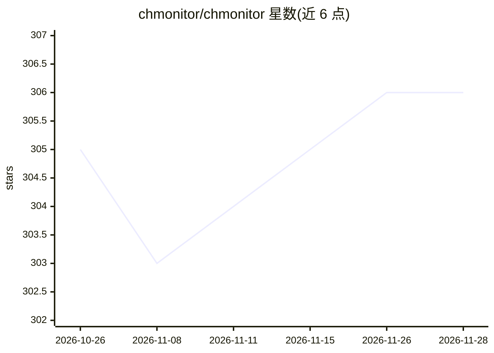

# chmonitor/chmonitor

⭐ 306 · TypeScript · GPL-3.0 · 推送 2026-11-25 · [GitHub](https://github.com/chmonitor/chmonitor) · [官网](https://chmonitor.dev) · 组织维护

**ClickHouse 集群的监控仪表盘与 AI 运维建议工具**

面向 ClickHouse 集群的仪表盘与顾问：读取 system.* 表展示查询、合并、复制、存储与健康状态，并提供 AI 建议（projections、skip indexes、PREWHERE、物化视图），明确不代为执行 DDL。支持多主机统一查看，带 chm CLI（TUI 与 chm doctor）、只读 SQL 控制台，内置 AI agent 并提供 MCP 接口供 Claude/Cursor 等客户端接入。可 Docker/K8s/Cloudflare Workers 等方式部署，GPL-3.0 自托管，另有可选商业许可（功能相同，提供发票与支持）。

## 筛选速览

| 维度 | 判定 | 备注 |
|---|---|---|
| AI 角色 | `ai-enhanced` | 去掉 AI 部分产品仍成立 |
| 许可风险 | `dual` | GPL-3.0 |
| 部署形态 | `desktop` | 安装包/桌面程序 |
| 模型依赖 | — | README 未给出锁定关系 |
| 硬件要求 | — | 无带数字的原话,不猜 |
| 安装摩擦 | `low` | 无编译、无系统依赖或容器化 |
| 成熟度 | — | 结构信号不足 |

## 能力要点

- 读取 system.* 表展示集群查询、合并、复制、存储与健康状况
- AI advisor 输出 projections、skip indexes、PREWHERE、物化视图建议，不自动执行 DDL
- 内置 AI agent + MCP，可从 Claude/Cursor 提问
- chm CLI 提供终端 TUI 与 chm doctor 检查

## 适用场景

- 实时查看 ClickHouse 集群的查询、副本与存储状态
- 让 AI 对索引、分区和物化视图给出调整建议作第二意见
- 在终端用 chm doctor 做集群体检
- 通过 Claude/Cursor 以自然语言询问 schema、存储与健康状况

## 场景标签

 · 领域:数据库运维/可观测性

## 证据(README 行号)

> L22: **chmonitor** is a dashboard and advisor for ClickHouse. It reads `system.*`
> L42: |Get a second opinion|AI advisor: projections, skip indexes, PREWHERE, MVs|
> L43: |Ask in English|Built-in AI agent + MCP for Claude / Cursor|

## 星数曲线

2026-10-26 305 → 2026-11-28 306（+1）

---
*卡片 v1 · prompt 1.4 · 生成 2026-11-25 · 置信度 high · 依据 README sha `ab88621e771f` · [字段定义](../../DATASET.md)*
