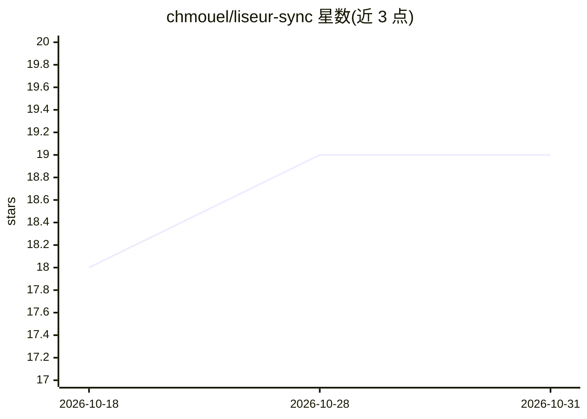

# chmouel/liseur-sync

⭐ 19 · Go · MIT · 推送 2026-10-28 · [GitHub](https://github.com/chmouel/liseur-sync) · [官网](https://f-droid.org/en/packages/com.chmouel.liseur/) · 个人维护

**自托管的电子书阅读进度同步与统计服务器**

Go 编写的单体二进制服务器，为 Liseur 提供配套服务，并为 KOReader 提供 kosync 兼容 API。功能覆盖阅读位置同步（append-only 日志、多设备冲突解决）、EPUB 索引与搜索（支持普通目录和 Calibre 库）、OPDS 1.2、浏览器 EPUB 阅读器（PWA 离线阅读）、按用户的阅读统计与会话、Audiobookshelf 章节同步，以及按账户的句子翻译缓存。默认 SQLite，可选 PostgreSQL，支持多用户与文件夹级权限。

## 筛选速览

| 维度 | 判定 | 备注 |
|---|---|---|
| AI 角色 | `ai-enhanced` | 去掉 AI 部分产品仍成立 |
| 许可风险 | `permissive` | MIT |
| 部署形态 | `self-host` | docker 或自建部署 |
| 模型依赖 | — | README 未给出锁定关系 |
| 硬件要求 | — | 无带数字的原话,不猜 |
| 安装摩擦 | `low` | 无编译、无系统依赖或容器化 |
| 成熟度 | — | 结构信号不足 |

## 能力要点

- append-only 阅读位置日志，多设备更新冲突解决
- 浏览器 EPUB 阅读器，PWA 离线阅读，EPUB 内嵌脚本不执行
- 索引普通 EPUB 目录或 Calibre metadata.db，通过 REST/OPDS/网页暴露目录
- kosync 兼容 API 供 KOReader 使用

## 适用场景

- 在 Liseur、KOReader 与浏览器阅读器之间同步阅读进度
- 自建电子书库并按用户分配文件夹访问权限
- 追踪自己的阅读时长与会话统计
- 离线携带已下载的书并在联网后回同步

## 场景标签

 · 领域:电子书/自托管服务器

## 证据(README 行号)

> L7: `liseur-sync` is the companion server for Liseur. It also provides a kosync-compatible API for KOReader.
> L29: * a per-account sentence translation cache.

## 星数曲线

2026-10-18 18 → 2026-10-31 19（+1）

---
*卡片 v1 · prompt 1.4 · 生成 2026-10-28 · 置信度 high · 依据 README sha `752ae0f75614` · [字段定义](../../DATASET.md)*
