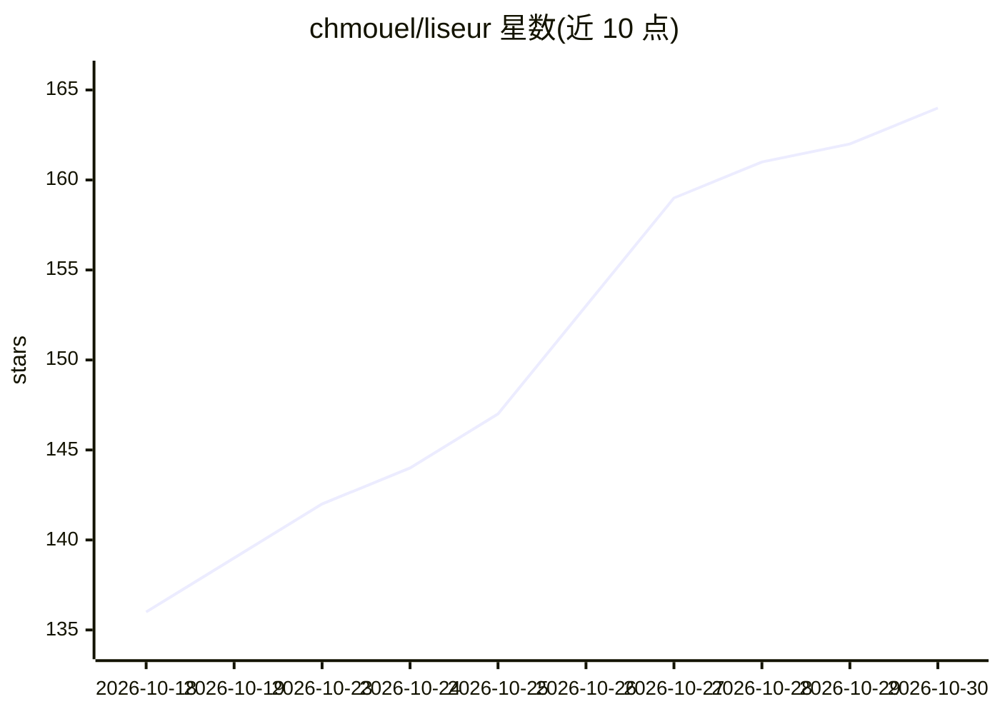

# chmouel/liseur

⭐ 164 · Kotlin · MIT · 推送 2026-10-29 · [GitHub](https://github.com/chmouel/liseur) · [官网](https://f-droid.org/en/packages/com.chmouel.liseur/) · 个人维护

**Android 开源 EPUB 阅读器，支持远程书库与 AI 阅读伴侣**

用 Jetpack Com 编写的 Android EPUB 阅读器，基于 Readium 引擎渲染，支持四种阅读主题、自动滚动、高亮笔记、字典查询、Android 翻译器或自选服务器逐句翻译、设备语音或自建语音服务朗读。可作为 calibre-web、Komga、BookOrbit、liseur-sync 或任意 OPDS 目录的客户端，统一书架管理与跨设备进度同步（精确到句子），内置 Project Gutenberg 免费书浏览。AI 阅读伴侣可回答角色与情节问题、生成角色档案与章节回顾；离线时在设备上构建人物/地点/群组的可搜索索引，联网答案由用户配置的服务器提供。无广告、无账号、自身代码无跟踪分析。

## 筛选速览

| 维度 | 判定 | 备注 |
|---|---|---|
| AI 角色 | `ai-enhanced` | 去掉 AI 部分产品仍成立 |
| 许可风险 | `permissive` | MIT |
| 部署形态 | `None` |  |
| 模型依赖 | — | README 未给出锁定关系 |
| 硬件要求 | — | 无带数字的原话,不猜 |
| 安装摩擦 | `low` | 无编译、无系统依赖或容器化 |
| 成熟度 | — | 结构信号不足 |

## 能力要点

- Readium 引擎渲染 EPUB，四种主题与逐书排版调节
- 阅读伴侣：基于前文的问答、角色档案与章节回顾，索引本地构建、答案来自配置的服务器
- 统一书架接入 calibre-web/Komga/BookOrbit/liseur-sync/OPDS，进度同步到句子级
- 朗读支持设备语音或自建语音服务器；翻译支持 Android 翻译器或自选服务器

## 适用场景

- 在手机上阅读本地或自建书库的 EPUB 图书并跨设备同步进度
- 长篇小说中查询角色关系、回顾此前情节
- 接入自托管的 calibre-web 或 liseur-sync 作为个人电子书方案

## 场景标签

`文档问答` · 领域:知识与检索

## 证据(README 行号)

> L13: An open-source ebook reader for Android, and a client for calibre-web, Komga, BookOrbit, liseur-sync and any OPDS c
> L52: The reading companion answers questions about characters and events using
> L62: The library is one shelf whatever the source: local folders, calibre-web,

## 星数曲线

2026-10-18 136 → 2026-10-30 164（+28）

---
*卡片 v1 · prompt 1.4 · 生成 2026-10-23 · 置信度 high · 依据 README sha `22f4a08578c1` · [字段定义](../../DATASET.md)*
