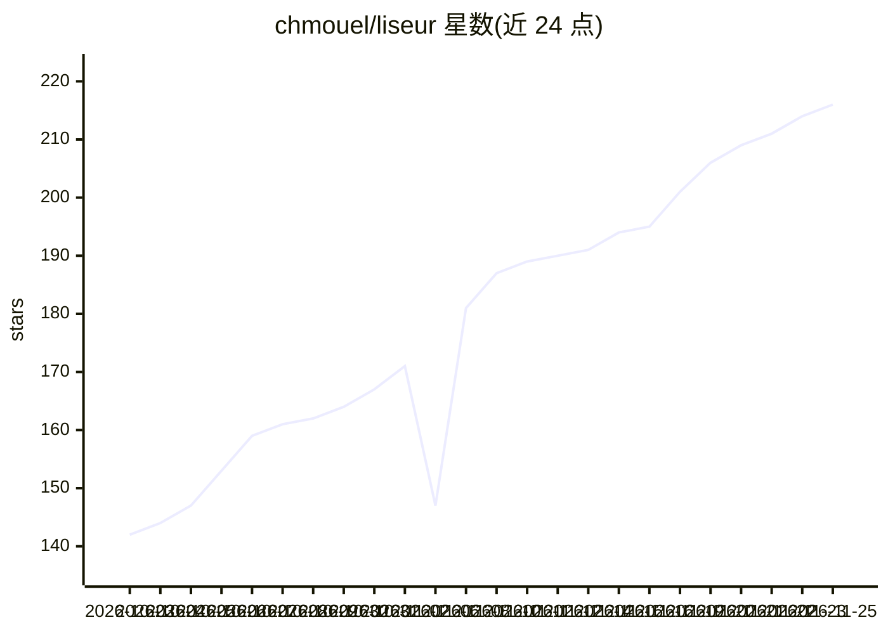

# chmouel/liseur

⭐ 216 · Kotlin · MIT · 推送 2026-11-23 · [GitHub](https://github.com/chmouel/liseur) · [官网](https://f-droid.org/en/packages/com.chmouel.liseur/) · 个人维护

**Android 开源 EPUB 阅读器，支持书库同步与本地阅读伴随**

面向 Android 的开源 EPUB 阅读器，同时作为 calibre-web、Komga、BookOrbit、liseur-sync 及任意 OPDS 目录的客户端，支持跨设备阅读位置同步到句子级。基于 Readium 引擎渲染，提供高亮、笔记、书签、词典、翻译与朗读；内置词汇本，以间隔重复复习并导出 Anki。阅读伴随功能在手机本地建立人物/地点/_groups 索引，问答与章节摘要需用户自行配置服务器。F-Droid/GitHub 构建无广告无跟踪，桌面版已弃置。

## 筛选速览

| 维度 | 判定 | 备注 |
|---|---|---|
| AI 角色 | `ai-enhanced` | 去掉 AI 部分产品仍成立 |
| 许可风险 | `permissive` | MIT |
| 部署形态 | `None` |  |
| 模型依赖 | — | README 未给出锁定关系 |
| 硬件要求 | — | 无带数字的原话,不猜 |
| 安装摩擦 | `low` | 无编译、无系统依赖或容器化 |
| 成熟度 | — | 结构信号不足 |

## 能力要点

- 支持 calibre-web、Komga、BookOrbit、liseur-sync 及任意 OPDS 目录的统一书架
- 阅读位置跨设备同步，精确到句子（后三者）
- 本地索引人物/地点/群体，无需服务器；问答与摘要通过自配服务器
- 词汇本间隔重复复习，可导出 Anki 兼容 CSV

## 适用场景

- 在手机上阅读 EPUB 并同步多设备的阅读进度
- 连接自托管书库服务器管理下载藏书
- 阅读外文书时积累词汇并按间隔重复复习
- 阅读长篇时查询角色与情节并查看章节回顾

## 场景标签

 · 领域:阅读/电子书工具

## 证据(README 行号)

> L13: An open-source ebook reader for Android, and a client for calibre-web, Komga, BookOrbit, liseur-sync and any OPDS c
> L91: The reading companion answers questions about characters and events using
> L94: without a server, the companion builds a searchable index of people, places

## 星数曲线

2026-10-23 142 → 2026-11-25 216（+74）

---
*卡片 v1 · prompt 1.4 · 生成 2026-11-25 · 置信度 high · 依据 README sha `85a1c3d2aa6c` · [字段定义](../../DATASET.md)*
