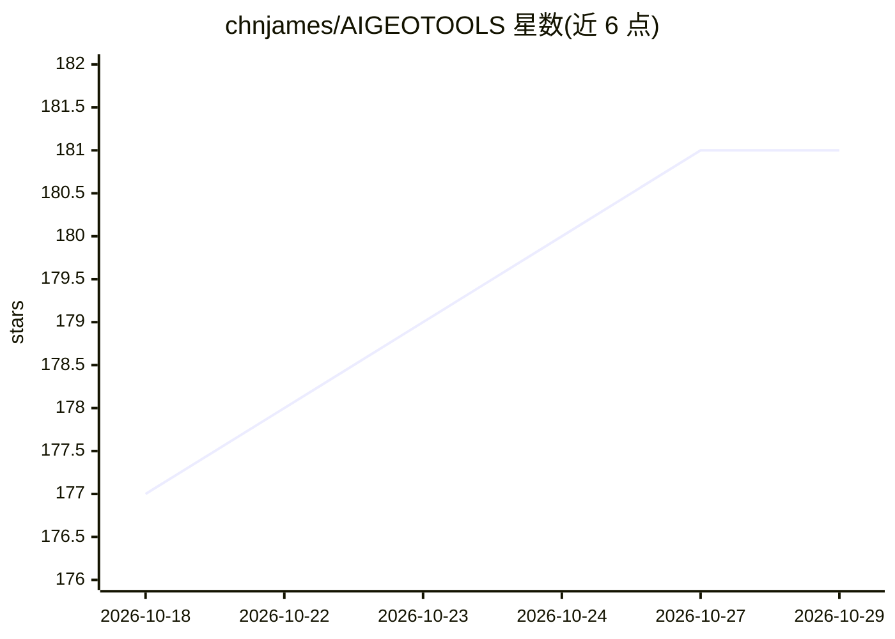

# chnjames/AIGEOTOOLS

⭐ 181 · Python · MIT · 推送 2026-10-22 · [GitHub](https://github.com/chnjames/AIGEOTOOLS) · 个人维护 · 中文 README

**帮企业在 AI 搜索回答中被优先引用的 GEO 内容优化平台**

面向品牌营销人员的 GEO（Generative Engine Optimization）内容策略工具：AI 生成关键词策略、按 20+ 平台模板生成内嵌 E-E-A-T 与品牌植入的内容，基于上传品牌文档的 RAG 检索保障来源，再用多模型（DeepSeek、OpenAI、通义千问等）与 Perplexity 真实搜索交叉验证品牌提及率，输出趋势、ROI 等数据分析，并支持 GitHub 一键发布与 12 平台复制。以 Streamlit Web 应用形式提供，git clone 源码安装，首次运行后在侧边栏配置 LLM API Key。

## 筛选速览

| 维度 | 判定 | 备注 |
|---|---|---|
| AI 角色 | `ai-native` | 本体是模型或模型工具 |
| 许可风险 | `permissive` | MIT |
| 部署形态 | `None` |  |
| 模型依赖 | locked-api |  |
| 硬件要求 | — | 无带数字的原话,不猜 |
| 安装摩擦 | `low` | 无编译、无系统依赖或容器化 |
| 成熟度 | — | 结构信号不足 |

## 能力要点

- 20+ 平台内容模板与 E-E-A-T 内嵌生成
- 品牌知识库 RAG 检索生成内容
- 多模型交叉验证 + Perplexity 真实 AI 搜索验证提及率
- 提及率趋势、平台贡献度、ROI 数据分析

## 适用场景

- 生成希望在 ChatGPT、Perplexity 回答中被引用的品牌内容
- 验证并跟踪品牌在各 AI 搜索引擎中的提及率
- 对比自有品牌与竞品在 AI 回答中的表现

## 场景标签

`RAG` `数据分析` `AI 写作` · 领域:效率与自动化

## 证据(README 行号)

> L14: **GEO（Generative Engine Optimization）智能内容优化平台** 是一款 AI 驱动的品牌内容策略工具，帮助企业在 AI 搜索引擎（如 ChatGPT、Perplexity、Google SGE）的回
> L40: - **20+ 平台模板**：知乎、小红书、CSDN、B站、微信公众号等
> L60: - **多模型验证**：DeepSeek、OpenAI、通义千问等多模型交叉验证

## 星数曲线

2026-10-18 177 → 2026-10-29 181（+4）

---
*卡片 v1 · prompt 1.4 · 生成 2026-10-22 · 置信度 high · 依据 README sha `92487e841d7a` · [字段定义](../../DATASET.md)*
