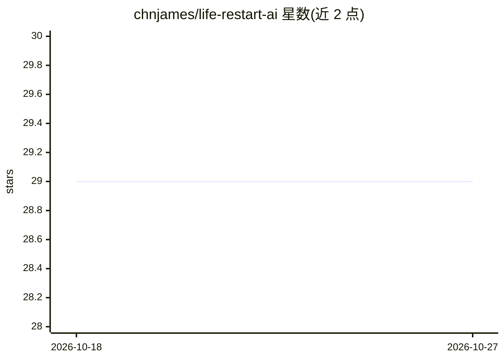

# chnjames/life-restart-ai

⭐ 29 · TypeScript · MIT · 推送 2026-07-23 · [GitHub](https://github.com/chnjames/life-restart-ai) · 个人维护 · 中文 README

**纯前端 AI 人生重开模拟器：事件与配图均由 AI 生成**

基于 Vue 3 + TypeScript 的纯前端人生重开模拟游戏：无预设剧本，所有事件由豆包 AI 根据玩家属性、年龄与历史经历实时生成，配图由 Seedream 图像模型渲染，角色档案参数（发型、脸型、肤色、色板等）用于保持跨回合外观一致。数据存于浏览器 localStorage，不经过后端；事件生成失败时自动降级到后备事件系统。用户需在设置页配置火山方舟 API Key（豆包必需，Seedream 可选），支持纯文本模式关闭图像生成。

## 筛选速览

| 维度 | 判定 | 备注 |
|---|---|---|
| AI 角色 | `ai-native` | 本体是模型或模型工具 |
| 许可风险 | `permissive` | MIT |
| 部署形态 | `library` | 以包/库形式分发 |
| 模型依赖 | — | README 未给出锁定关系 |
| 硬件要求 | — | 无带数字的原话,不猜 |
| 安装摩擦 | `low` | 无编译、无系统依赖或容器化 |
| 成熟度 | — | 结构信号不足 |

## 能力要点

- 零预设剧本，事件由豆包 AI 基于玩家状态动态生成
- Seedream 为每个事件生成配图，局部编辑保持角色外观连贯
- 纯前端实现，数据仅存 localStorage，支持导出/导入存档
- API 配置在应用设置页面完成，非环境变量

## 适用场景

- 玩每次都不同的人生模拟文字游戏
- 通过选择推进 AI 生成的剧情事件
- 创建自定义外观与属性的角色体验重开人生

## 场景标签

 · 领域:游戏/AI 娱乐应用

## 证据(README 行号)

> L3: 一个基于 Vue 3 + TypeScript 的纯前端人生重开模拟游戏。所有事件由豆包 AI 实时生成，配图由 Seedream 图像模型渲染，每次重开都是独一无二的人生故事。
> L13: - 零预设剧本，所有事件由豆包 AI 基于玩家属性、年龄、历史经历动态生成
> L17: - Seedream 为每个事件生成专属配图，优先使用局部编辑保持角色外观一致性

## 星数曲线

2026-10-18 29 → 2026-10-27 29（+0）

---
*卡片 v1 · prompt 1.4 · 生成 2026-10-26 · 置信度 high · 依据 README sha `a17472ceb1c1` · [字段定义](../../DATASET.md)*
