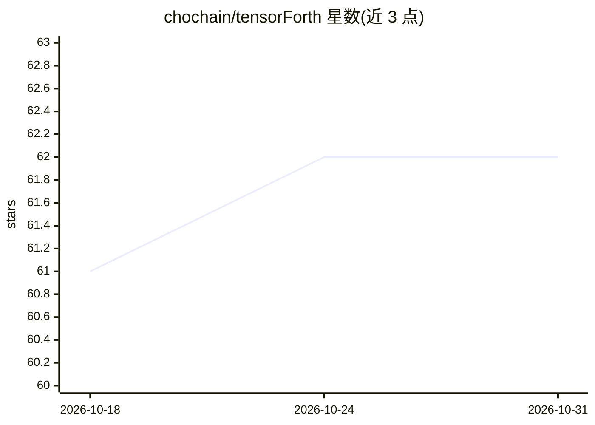

# chochain/tensorForth

⭐ 62 · C++ · MIT · 推送 2026-08-04 · [GitHub](https://github.com/chochain/tensorForth) · 个人维护

**在 GPU 上做张量与机器学习的 Forth 虚拟机（CUDA）**

以 CUDA 实现的 Forth 虚拟机，提供 vector/matrix/tensor 对象、GEMM、CNN 网络层（conv2d/linear/pooling/activation/loss）、autograd 反向传播、SGD/Adam 等优化方法及 MNIST 数据加载，可训练并持久化模型，另含 GAN 支持与 TensorBoard 输出（v4.0 beta）。当前 v5.0 开发中的功能为 Transformer 算子。VM 运行于主机端、将计算任务下发 GPU；CUDA12+ 版本面向 Turing/Ampere 及以上显卡，CUDA11.4 旧版仅支持 Kepler—Volta。构建需 Docker + CUDA 容器或 CMake 从源码编译，面向熟悉 Forth 与 GPU 的研究/开发者。

## 筛选速览

| 维度 | 判定 | 备注 |
|---|---|---|
| AI 角色 | `ai-native` | 本体是模型或模型工具 |
| 许可风险 | `permissive` | MIT |
| 部署形态 | `self-host` | docker 或自建部署 |
| 模型依赖 | — | README 未给出锁定关系 |
| 硬件要求 | — | 无带数字的原话,不猜 |
| 安装摩擦 | `low` | 无编译、无系统依赖或容器化 |
| 成熟度 | `idea` | |

## 能力要点

- Forth VM + tensor/matrix 对象与 GEMM（CUDA Dynamic Parallelism）
- CNN 模型构建、autograd 反向传播、SGD/Adam 训练与模型持久化
- MNIST 数据集加载、OpenGL 数据集查看器、TensorBoard 输出（v4.0）
- 支持多个并行 Forth VM 与 TLSF 张量存储管理

## 适用场景

- 在 GPU 上以交互式 Forth REPL 做线性代数与矩阵运算
- 用内建层搭建并训练 CNN（如 MNIST）与 GAN
- 在支持 CUDA 的显卡上以交互增量方式开发/调试 AI 模型

## 场景标签

`模型训练` · 领域:训练与推理

## 证据(README 行号)

> L4: * Forth VM that supports tensor calculus and Convolution Neural Network with dynamic parallelism in CUDA
> L60: |3.0|**CNN**|production|+ Machine Learning with autograd|Torch|
> L88:  * NN model creation and persistence

## 星数曲线

2026-10-18 61 → 2026-10-31 62（+1）

---
*卡片 v1 · prompt 1.4 · 生成 2026-10-24 · 置信度 high · 依据 README sha `fc857eb6e694` · [字段定义](../../DATASET.md)*
