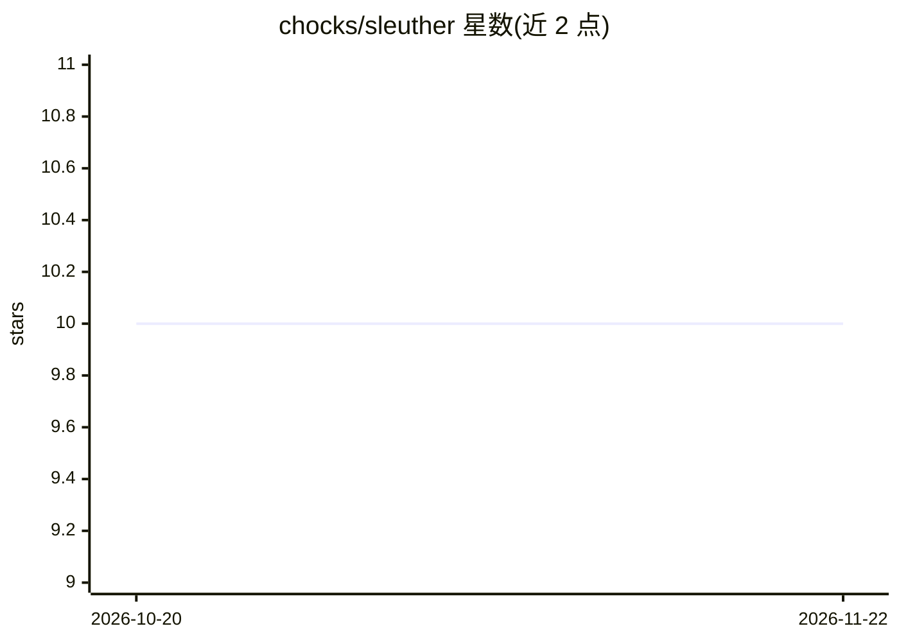

# chocks/sleuther

⭐ 10 · Shell · MIT · 推送 2026-03-22 · [GitHub](https://github.com/chocks/sleuther) · 个人维护

**终端用户的 zsh 命令报错本地 LLM 诊断插件**

面向 Oh My Zsh 用户的 shell 插件：通过 zsh 钩子捕获失败命令，将命令文本与退出码发送至本地 Ollama 服务，输出根因解释与一条建议修复命令，执行前需用户确认。默认仅访问 loopback 地址，拒绝非本地端点，禁止链式/管道/重定向等复合命令，破坏性命令被拦截执行。提供手动粘贴错误的模式、脱敏导出报告与 glow 可选渲染。限制：钩子无法获取上一命令的 stdout/stderr，自动模式下模型仅见命令与退出码。

## 筛选速览

| 维度 | 判定 | 备注 |
|---|---|---|
| AI 角色 | `ai-native` | 本体是模型或模型工具 |
| 许可风险 | `permissive` | MIT |
| 部署形态 | `library` | 以包/库形式分发 |
| 模型依赖 | local-ok | 支持本地模型 |
| 硬件要求 | — | 无带数字的原话,不猜 |
| 安装摩擦 | `low` | 无编译、无系统依赖或容器化 |
| 成熟度 | — | 结构信号不足 |

## 能力要点

- 通过 zsh 钩子自动捕获失败命令并调用本地 Ollama 解释根因
- 默认仅 loopback 端点，非本地 URL 被拒绝重置
- 建议命令以 argv 形式执行，链式/管道/重定向/子 shell 被阻止
- 默认模型 qwen2.5-coder:7b，可配置超时与 keep_alive

## 适用场景

- 命令报错时在终端直接看到根因与修复建议
- 粘贴报错文本获取更精确的诊断
- 不希望终端数据离开本机的环境下排障

## 场景标签

 · 领域:开发者工具/终端

## 证据(README 行号)

> L3: Local terminal error triage for Oh My Zsh, backed by Ollama.
> L12: - Sends the failed command, exit code, and available context to your local Ollama server.

## 星数曲线

2026-10-20 10 → 2026-11-22 10（+0）

---
*卡片 v1 · prompt 1.4 · 生成 2026-11-19 · 置信度 mid · 依据 README sha `722748f3169e` · [字段定义](../../DATASET.md)*
