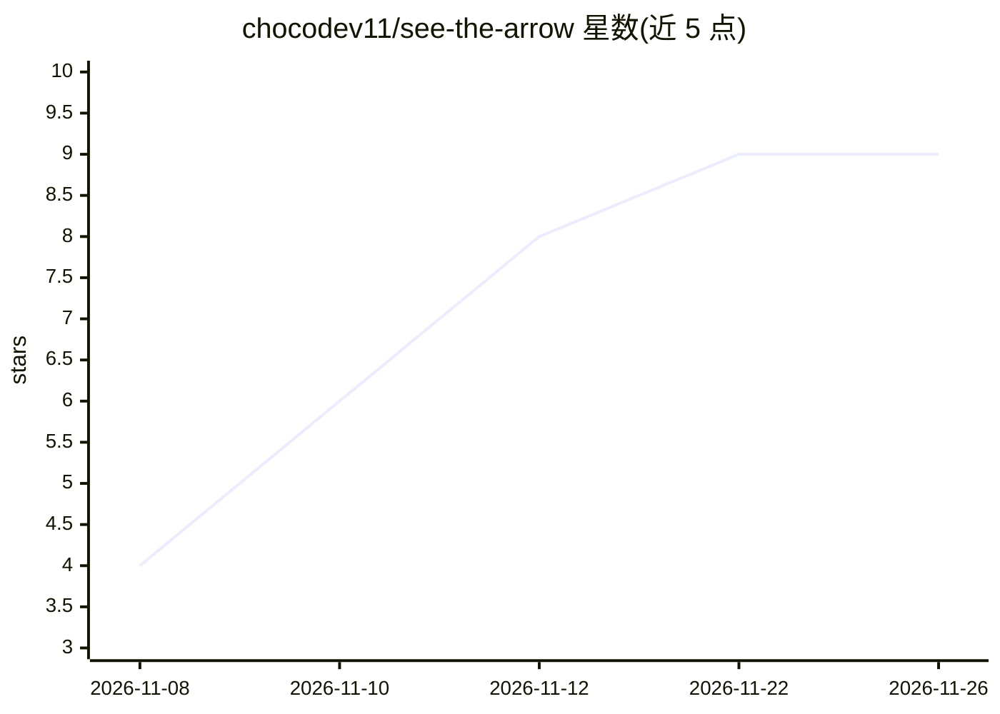

# chocodev11/see-the-arrow

⭐ 9 · Rust · NOASSERTION · 推送 2026-10-12 · [GitHub](https://github.com/chocodev11/see-the-arrow) · 个人维护

**AI agent 指路用的屏幕箭头工具：教人而不是替人点**

用 Rust 编写的 CLI 工具 bigarrow，在任何窗口上方绘制带提示牌的大箭头、圆环或方框，支持 Windows 10/11 与 Linux X11。AI agent（如 Claude Code、Codex）通过它逐步骤指示用户点击位置，用户自己完成点击以学会应用操作。定位方式有两种：在提供 UI Automation（Windows）或 AT-SPI（Linux）标签的应用中按控件名定位，无标签时由 agent 截图读取像素坐标。箭头可穿透点击、不抢焦点、自动消失，工具本身不点击不输入。安装方式为下载二进制、或 cargo 从源码编译（需 Rust 1.89+）。

## 筛选速览

| 维度 | 判定 | 备注 |
|---|---|---|
| AI 角色 | `ai-enhanced` | 去掉 AI 部分产品仍成立 |
| 许可风险 | `permissive` | NOASSERTION |
| 部署形态 | `desktop` | 安装包/桌面程序 |
| 模型依赖 | — | README 未给出锁定关系 |
| 硬件要求 | — | 无带数字的原话,不猜 |
| 安装摩擦 | `medium` | 含编译或系统依赖之一 |
| 成熟度 | — | 结构信号不足 |

## 能力要点

- 按控件名（--element）或截图像素坐标定位目标
- 箭头穿透点击、不抢键盘焦点、支持多箭头并排
- --until-click 等待用户点击后 agent 再截图推进
- install-skill 安装 Claude Code 与 Codex 的 agent skill

## 适用场景

- 让 AI agent 一步步教我使用 Blender 等自绘界面的应用
- 需要管理员权限、支付或验证码等必须由人操作的步骤时由 agent 指路
- 在屏幕上标注应用界面并给提示文字做讲解

## 场景标签

 · 领域:桌面工具/人机交互辅助

## 证据(README 行号)

> L17: see-the-arrow draws a big arrow with a sign on top of any window, on Windows and Linux. An AI agent
> L150: bigarrow install-skill                 # Claude Code (~/.claude/skills) and Codex (~/.agents/skills)
> L153: Windows 10 or 11 needs nothing else. Linux needs an X11 session; a compositing window manager gives

## 星数曲线

2026-11-08 4 → 2026-11-26 9（+5）

---
*卡片 v1 · prompt 1.4 · 生成 2026-11-20 · 置信度 high · 依据 README sha `51fab1506d95` · [字段定义](../../DATASET.md)*
