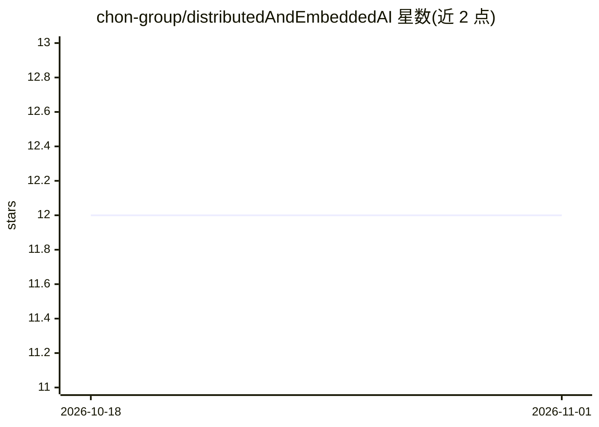

# chon-group/distributedAndEmbeddedAI

⭐ 12 · ASL · 推送 2026-10-24 · [GitHub](https://github.com/chon-group/distributedAndEmbeddedAI) · 组织维护

**嵌入式多智能体系统（MAS）教学课程工具包**

面向学术界与专业人士的分布式人工智能（DAI）教学课程与工具包：基于嵌入式多智能体系统（Embedded MAS）与 BDI 智能体，使用 Jason 框架的嵌入式定制版本开发认知设备。提供 DIY 方法，包含方法、软件、教学材料、硬件电路图与实验代码，覆盖五层架构设计；支持通过既有网络通信、智能体在系统间迁移，并可用串口通信仿真设备与硬件组件，在部署前提供可测试实例。内容含单智能体、多智能体、通信智能体、移动智能体与嵌入式智能体等章节。采用 CC BY 4.0 许可。

## 筛选速览

| 维度 | 判定 | 备注 |
|---|---|---|
| AI 角色 | `ai-knowledge` | 知识聚合/清单类 |
| 许可风险 | `none` | — |
| 部署形态 | `None` |  |
| 模型依赖 | — | README 未给出锁定关系 |
| 硬件要求 | — | 无带数字的原话,不猜 |
| 安装摩擦 | `low` | 无编译、无系统依赖或容器化 |
| 成熟度 | — | 结构信号不足 |

## 能力要点

- Jason 框架的嵌入式专用版本开发 BDI 智能体
- 五层架构的 DIY 教学方法与硬件电路图
- 串口通信仿真设备与硬件组件，部署前可测试
- 支持智能体跨系统迁移与网络通信

## 适用场景

- 学习嵌入式多智能体系统的开发方法
- 教学场景下开展分布式 AI 与 BDI 智能体实验
- 在仿真环境中先测试认知设备再实际部署

## 场景标签

`多智能体` `教程课程` · 领域:Agent 开发

## 证据(README 行号)

> L1: # Introduction to Distributed and Embedded Artificial Intelligence
> L5: In this course, students will:

## 星数曲线

2026-10-18 12 → 2026-11-01 12（+0）

---
*卡片 v1 · prompt 1.4 · 生成 2026-11-01 · 置信度 high · 依据 README sha `f3aa4da0c5b4` · [字段定义](../../DATASET.md)*
