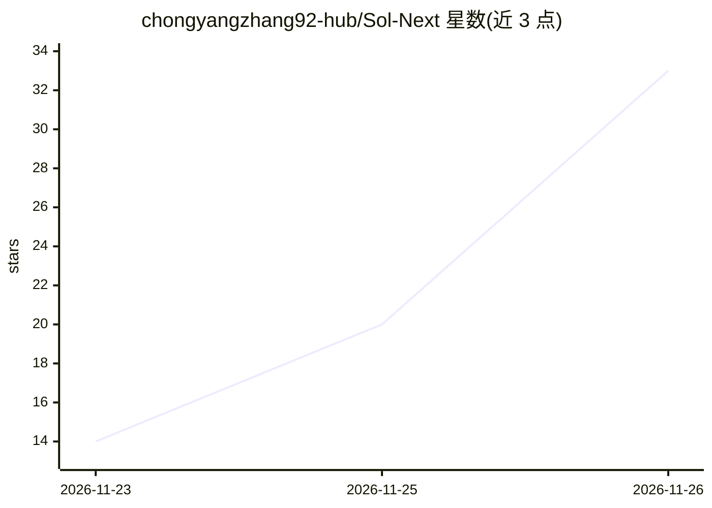

# chongyangzhang92-hub/Sol-Next

⭐ 33 · Python · Apache-2.0 · 推送 2026-11-25 · [GitHub](https://github.com/chongyangzhang92-hub/Sol-Next) · [官网](https://chongyangzhang92-hub.github.io/Sol-Next/) · 个人维护 · 中文 README

**安卓 10–16 端云协同 AI 手机助理：后台虚拟屏自动执行任务**

基于 Mika（Apache-2.0）重构的安卓 AI 手机 Agent，公开版 APK 零内置 API Key，采用 BYOK 模式由用户填入自己的模型服务商密钥直连官方接口。核心机制包括 Rust JNI 内核做 UI 控件树剪枝与 SSE 流式步骤解析、1:1 克隆物理屏的后台 VirtualDisplay、64 轮长任务防暂停自愈、非默认拨号器的 AI 接打电话模块（支持实时语音与 DTMF），并提供零依赖 CLI 与 MCP Server 接入 AI 编程助手。敏感操作前有手动确认门控。

## 筛选速览

| 维度 | 判定 | 备注 |
|---|---|---|
| AI 角色 | `ai-native` | 本体是模型或模型工具 |
| 许可风险 | `permissive` | Apache-2.0 |
| 部署形态 | `None` |  |
| 模型依赖 | locked-api |  |
| 硬件要求 | — | 无带数字的原话,不猜 |
| 安装摩擦 | `low` | 无编译、无系统依赖或容器化 |
| 成熟度 | — | 结构信号不足 |

## 能力要点

- Rust v3.10 JNI 内核：UI 树剪枝 17–45 µs、BM25 路由与 SSE 流式步骤解析下沉端侧
- 1:1 复刻 Display 0 物理参数的后台虚拟屏（0.0px 漂移直击点击）
- 64 轮防暂停自愈与小米 HyperOS 专项适配，支持断点续跑
- 运营商级 AI 电话（豆包 Seeduplex 3.0 / OpenAI Realtime BYOK）+ 3×4 DTMF 拨号盘

## 适用场景

- 在手机后台让 AI 自动跨 App 执行多步任务
- 让 AI 代为接打电话并操作语音菜单
- 小米 HyperOS 上跑长任务不被系统中断
- 通过 MCP 让 Claude/Cursor 直接控制手机执行指令

## 场景标签

`GUI 自动化` `语音 Agent` · 领域:效率与自动化

## 证据(README 行号)

> L40: **Sol Next** 是一款面向 Android 10–16 的**极速端云协同 AI 手机助理**：
> L43: - **🦀 Rust v3.10 原生内核加速**：将 UI 控件树极限剪枝（`-74%~-97%`，耗时仅 `17–45 µs`）、System-0 BM25+同义词语义路由（`51 µs` · 0 Token）、SSE 流式增
> L176:  支持。沿用并完善了 Mika 的非默认拨号器 Telecom Companion 架构，**保留你的系统原生拨号器**，支持豆包 Seeduplex 3.0 与 OpenAI Realtime（BYOK）、3×4 DTMF 语

## 星数曲线

2026-11-23 14 → 2026-11-26 33（+19）

---
*卡片 v1 · prompt 1.4 · 生成 2026-11-23 · 置信度 high · 依据 README sha `4f8b4396109d` · [字段定义](../../DATASET.md)*
