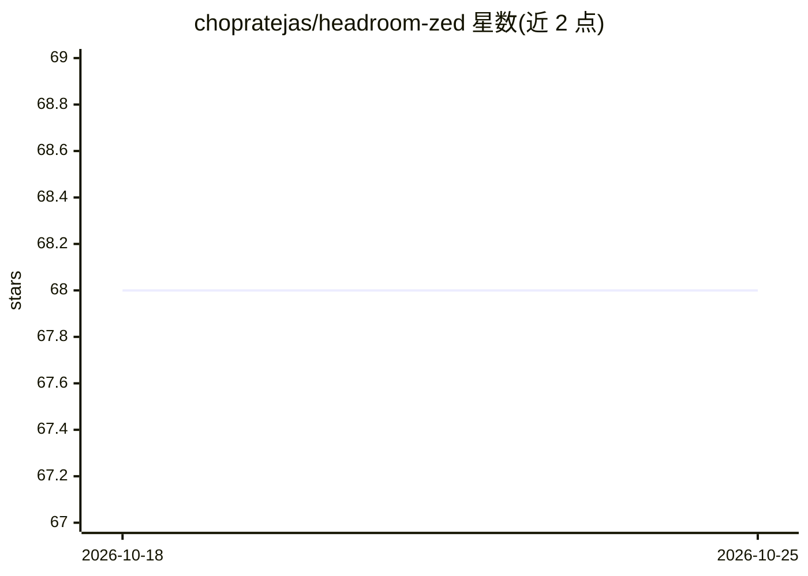

# chopratejas/headroom-zed

⭐ 69 · Rust · NOASSERTION · 推送 2026-03-18 · [GitHub](https://github.com/chopratejas/headroom-zed) · [官网](https://github.com/chopratejas/headroom) · 个人维护

**Zed 编辑器扩展：为 AI agent 接入 Headroom 上下文压缩 MCP 工具**

面向 Zed 编辑器用户的扩展，将 Headroom 注册为 MCP 上下文服务器，使 Zed 的 AI agent 获得三个按需工具：压缩大文件/JSON/日志/搜索结果、按 hash 取回原始内容、查看会话节省统计。可选启动 headroom proxy 对所有 LLM 请求自动压缩（README 称 50-90% token 减少）。压缩使用 SmartCrusher、CodeCompressor、Kompress 管线，原件本地保存可随时取回。需先 pip 安装 headroom-ai（Python 3.10+）。

## 筛选速览

| 维度 | 判定 | 备注 |
|---|---|---|
| AI 角色 | `ai-ecosystem` | LLM/agent 周边工具 |
| 许可风险 | `none` | NOASSERTION |
| 部署形态 | `library` | 以包/库形式分发 |
| 模型依赖 | — | README 未给出锁定关系 |
| 硬件要求 | — | 无带数字的原话,不猜 |
| 安装摩擦 | `low` | 无编译、无系统依赖或容器化 |
| 成熟度 | — | 结构信号不足 |

## 能力要点

- 注册 Headroom 为 MCP 服务器，提供压缩/取回/统计三个工具
- 可选 proxy 模式自动压缩所有 LLM 请求
- JSON/代码/文本分别走 SmartCrusher、CodeCompressor、Kompress 管线
- 原始内容本地保留，按 hash 可完整取回

## 适用场景

- 在 Zed 中让 agent 处理大文件时节省 token 与成本
- 查看会话中压缩节省的 token 统计
- 自动压缩每次 LLM 请求以降低成本

## 场景标签

 · 领域:开发工具/LLM 上下文优化

## 证据(README 行号)

> L7: This extension registers Headroom as an MCP context server in Zed, giving the AI agent three tools:
> L50: The extension tells Zed to run `headroom mcp serve` as a background process. This starts Headroom's MCP server, whi

## 星数曲线

2026-10-18 68 → 2026-10-25 68（+0）

---
*卡片 v1 · prompt 1.4 · 生成 2026-10-24 · 置信度 high · 依据 README sha `e8383240a0e2` · [字段定义](../../DATASET.md)*
