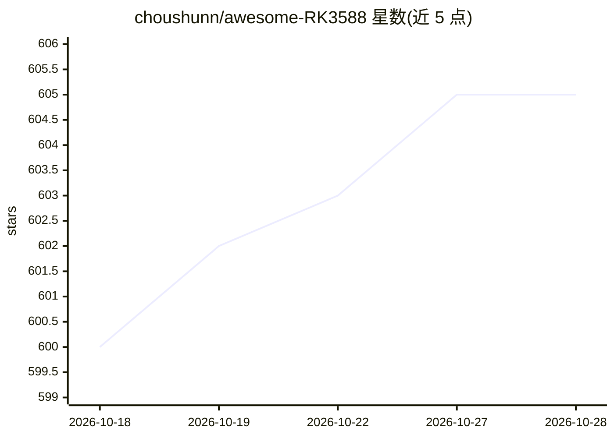

# choushunn/awesome-RK3588

⭐ 606 · CC0-1.0 · 推送 2025-12-07 · [GitHub](https://github.com/choushunn/awesome-RK3588) · 个人维护 · 中文 README

**RK3588 芯片开发资源策展清单：SDK、模型、板卡、系统一册收**

面向嵌入式开发者的 Rockchip RK3588（四核 A76+四核 A55、6 TOPS NPU）资源清单：收录官方内核/SDK 文档、RKNN 与 RKLLM 工具链、30+ 预训练模型的 Model Zoo、支持的操作系统（Ubuntu/Armbian/Buildroot/NixOS）、示例项目、开发板（Orange Pi 5、Radxa ROCK 5、LubanCat 等）及中英文社区入口。条目为链接目录形式，不提供可运行代码本体，内容按类别组织，接受社区 PR 贡献。

## 筛选速览

| 维度 | 判定 | 备注 |
|---|---|---|
| AI 角色 | `ai-knowledge` | 知识聚合/清单类 |
| 许可风险 | `viral` | CC0-1.0 |
| 部署形态 | `None` |  |
| 模型依赖 | — | README 未给出锁定关系 |
| 硬件要求 | — | 无带数字的原话,不猜 |
| 安装摩擦 | `medium` | 含编译或系统依赖之一 |
| 成熟度 | — | 结构信号不足 |

## 能力要点

- 覆盖 RKNN-Toolkit2/RKNPU2/RKLLM 等 NPU 工具链条目
- 收录边缘 LLM 部署支持（TinyLlama、Qwen2、Whisper 等模型）
- 按操作系统、开发板、文档、社区分类的中英文资源入口

## 适用场景

- RK3588 板卡选型时查找开发板与系统镜像资源
- 边缘 AI 项目中定位 RKNN 模型转换与 NPU 部署工具
- 在 RK3588 上部署边缘 LLM 时查找 RKLLM 相关资料

## 场景标签

`精选清单` · 领域:学习与行业

## 证据(README 行号)

> L5: RK3588 is Rockchip's flagship 8K SoC with quad Cortex-A76, quad Cortex-A55, and 6 TOPS NPU. This list curates essent
> L7: ## Contents

## 星数曲线

2026-10-18 600 → 2026-10-28 605（+5）

---
*卡片 v1 · prompt 1.4 · 生成 2026-10-21 · 置信度 high · 依据 README sha `a26bec7e7ac5` · [字段定义](../../DATASET.md)*
