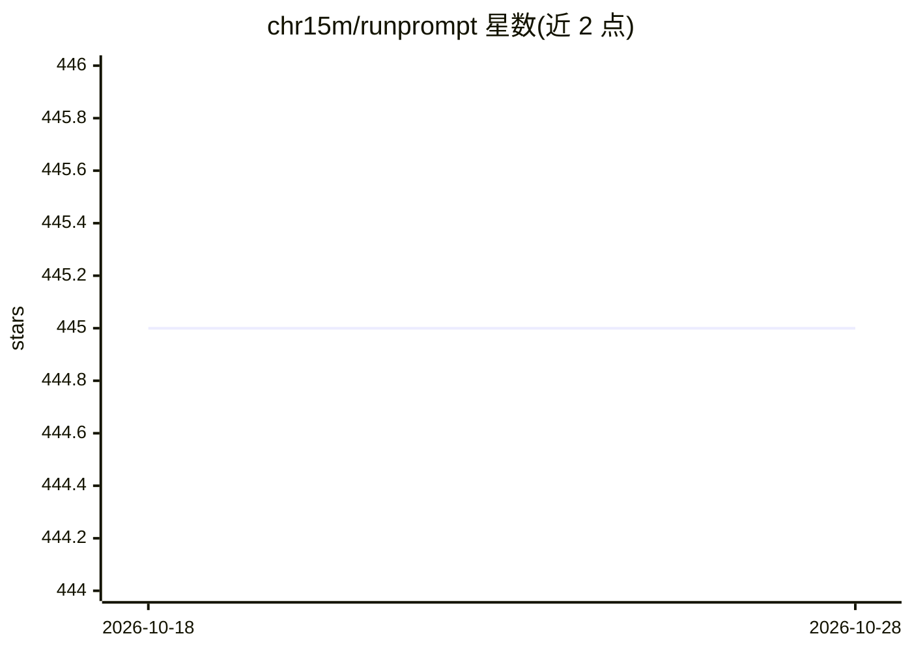

# chr15m/runprompt

⭐ 445 · Python · MIT · 推送 2026-09-07 · [GitHub](https://github.com/chr15m/runprompt) · 个人维护

**在 shell 中运行 .prompt 文件获得 LLM 结构化响应的单文件 Python 脚本**

面向开发者的命令行工具：将提示词、模型、输出 schema、配置、工具定义打包进单个 .prompt 文件（YAML frontmatter + 模板），从 shell 直接运行并输出文本或 JSON。支持管道串联多个 prompt、前置 shell 命令注入上下文、Python 函数与 shell 脚本作为 LLM 可调用工具（带确认机制与 safe 标记）、交互式 chat 模式、文件/URL 附件与内置工具集。以单文件脚本分发，也可经 pip/uv 作为库安装，可将 prompt 文件作为可执行工件纳入版本库。

## 筛选速览

| 维度 | 判定 | 备注 |
|---|---|---|
| AI 角色 | `ai-ecosystem` | LLM/agent 周边工具 |
| 许可风险 | `permissive` | MIT |
| 部署形态 | `library` | 以包/库形式分发 |
| 模型依赖 | locked-api |  |
| 硬件要求 | — | 无带数字的原话,不猜 |
| 安装摩擦 | `low` | 无编译、无系统依赖或容器化 |
| 成熟度 | — | 结构信号不足 |

## 能力要点

- .prompt 单文件包含提示词、模型、schema 与工具定义
- Picoschema 结构化 JSON 输出与 prompt 管道串联
- Python 函数/shell 脚本/内置工具作为 LLM 工具，带确认与 safe 自动批准机制
- 交互式 chat 模式与 /read、/edit 等动态上下文命令

## 适用场景

- 把 LLM 提示词作为可版本化工件在命令行中运行
- 在 shell 管道中串联多个 prompt 自动化 AI 工作流
- 让 LLM 在带确认机制下调用 Python 或 shell 工具执行任务

## 场景标签

`提示工程` · 领域:Agent 开发

## 证据(README 行号)

> L3: Run LLM .prompt files from your shell with a single-file Python script.
> L5: A .prompt file contains the prompt and metadata (model, schema, config) in a single file. You can use it to run LLM 
> L258: Tools allow the LLM to call Python functions during prompt execution. Define tools as Python functions with docstr

## 星数曲线

2026-10-18 445 → 2026-10-28 445（+0）

---
*卡片 v1 · prompt 1.4 · 生成 2026-10-21 · 置信度 high · 依据 README sha `c6fa5e91fe91` · [字段定义](../../DATASET.md)*
