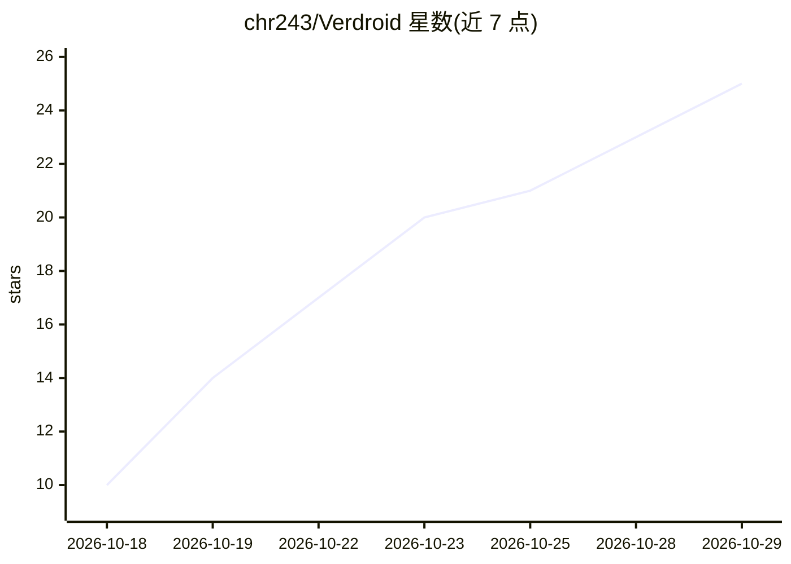

# chr243/Verdroid

⭐ 25 · C++ · GPL-3.0 · 推送 2026-10-27 · [GitHub](https://github.com/chr243/Verdroid) · 个人维护

**安卓端侧 AI agent 应用：免费模型驱动的多工具自动化助手**

面向 Android 用户的本地 AI agent 应用（Kotlin/Jetpack Compose）。默认面向 OpenRouter 免费模型与 Kilo（免 key），支持模型优先级、跨模型与 key 自动回退及限流恢复，也可接入 OpenAI/Groq/DeepSeek/Ollama 等任意 OpenAI 兼容 API（BYOK，key 加密存于设备），并可导入 .gguf/.litertlm 模型本地运行。工具覆盖多引擎网页搜索与抓取、Termux 内 bash/Python（可选无头 Chromium+Selenium）、Shizuku/rish shell、文件与 Git、整本电子书翻译、加密货币策略回测、定时任务，以及可选的 Accessibility 屏幕操作与 X/Reddit 访问。无服务器、无云端后端，通过 GitHub release 分发。

## 筛选速览

| 维度 | 判定 | 备注 |
|---|---|---|
| AI 角色 | `ai-native` | 本体是模型或模型工具 |
| 许可风险 | `viral` | GPL-3.0 |
| 部署形态 | `library` | 以包/库形式分发 |
| 模型依赖 | local-ok | 支持本地模型 |
| 硬件要求 | — | 无带数字的原话,不猜 |
| 安装摩擦 | `medium` | 含编译或系统依赖之一 |
| 成熟度 | `idea` | |

## 能力要点

- OpenRouter 免费模型与 Kilo 工具调用，模型/key 自动回退与限流恢复
- Termux 内 bash/Python 执行，可选无头 Chromium+Selenium 抓取
- 无 key 多引擎并行网页搜索与整本电子书翻译（MOBI/EPUB/PDF/DOCX/TXT）
- 对话式加密货币策略回测（离线历史数据、含费用与滑点）与本地 .gguf 模型运行

## 适用场景

- 在手机上用免费 LLM 完成搜索、抓取、脚本执行等实际任务
- 把 MOBI/EPUB 等电子书整本翻译成目标语言
- 用自然语言描述并离线回测加密货币交易策略
- 通过定时任务自动检查网站并在有更新时通知

## 场景标签

`AI 助手` `浏览器自动化` `网页抓取` `金融量化` · 领域:效率与自动化

## 证据(README 行号)

> L8: **An on-device AI agent for Android that actually does things:** it searches the web and fetches pages and APIs over
> L27: - **Free-model agent loop:** tool calling on OpenRouter free models and Kilo, priority list, automatic fallback acr

## 星数曲线

2026-10-18 10 → 2026-10-29 25（+15）

---
*卡片 v1 · prompt 1.4 · 生成 2026-10-28 · 置信度 mid · 依据 README sha `1b9d34df29a8` · [字段定义](../../DATASET.md)*
