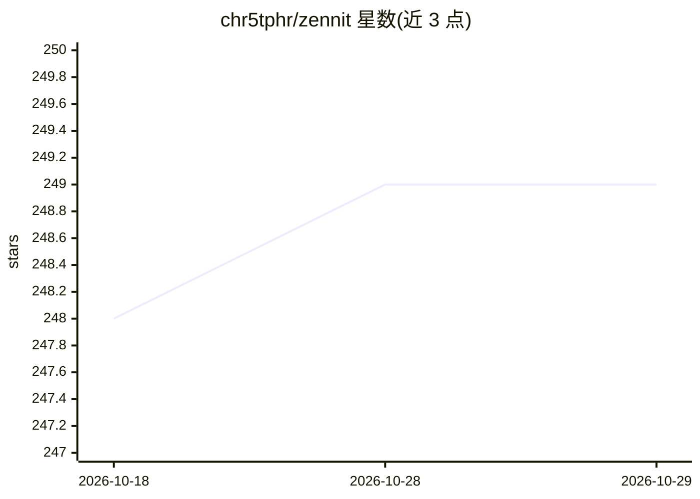

# chr5tphr/zennit

⭐ 249 · Python · LGPL-3.0 · 推送 2026-05-13 · [GitHub](https://github.com/chr5tphr/zennit) · 组织维护

**基于 PyTorch 的神经网络归因解释框架，聚焦 LRP**

Python 高层框架，通过在 PyTorch Module 层注册 hook 修改反向传播，产出 LRP 等基于规则的归因（热力图），供研究人员解释神经网络预测。提供按层名/类型分配规则的 Composites、将模型转为规范形式的 Canonizers（如合并 BatchNorm）、以及 Gradient/SmoothGrad/Occlusion 等 Attributors。严格要求模型使用 torch.nn.Module 结构（含激活函数）。README 自述处于活跃开发、大体稳定，并提供相关论文供引用。

## 筛选速览

| 维度 | 判定 | 备注 |
|---|---|---|
| AI 角色 | `ai-ecosystem` | LLM/agent 周边工具 |
| 许可风险 | `viral` | LGPL-3.0 |
| 部署形态 | `library` | 以包/库形式分发 |
| 模型依赖 | — | README 未给出锁定关系 |
| 硬件要求 | — | 无带数字的原话,不猜 |
| 安装摩擦 | `low` | 无编译、无系统依赖或容器化 |
| 成熟度 | `idea` | |

## 能力要点

- 在 Module 层注册 hook 修改反向传播以产出 LRP 等规则式归因
- Composites 按层名/类型分配规则（如 EpsilonGammaBox、EpsilonPlus）
- Canonizers 自动合并 BatchNorm、处理 ResNet 残差连接
- Attributors 支持 Gradient、SmoothGrad、Occlusion 及混合方法

## 适用场景

- 研究神经网络预测的 LRP/归因热力图
- 对 VGG16、ResNet50 等模型做可解释性分析
- 科研论文中需要规则式归因方法的标准实现

## 场景标签

`科研工具` · 领域:学习与行业

## 证据(README 行号)

> L8: Zennit (**Z**ennit **e**xplains **n**eural **n**etworks **i**n **t**orch) is a
> L11: integration as a standardized solution for applying rule-based attribution
> L45: At its heart, Zennit registers hooks at Pytorch's Module level, to modify the

## 星数曲线

2026-10-18 248 → 2026-10-29 249（+1）

---
*卡片 v1 · prompt 1.4 · 生成 2026-10-22 · 置信度 high · 依据 README sha `f374e775e501` · [字段定义](../../DATASET.md)*
