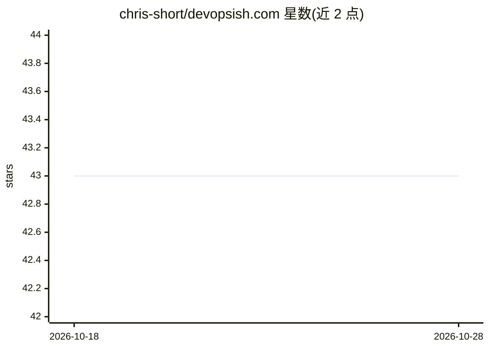

# chris-short/devopsish.com

⭐ 43 · HTML · MIT · 推送 2026-10-25 · [GitHub](https://github.com/chris-short/devopsish.com) · [官网](https://devopsish.com) · 个人维护

**Chris Short 维护的 Cloud Native/DevOps/AI 技术新闻通讯**

由 Chris Short 撰写并部署在 Netlify 的新闻通讯网站，主题覆盖 Cloud Native、DevOps、开源、AI 与技术行业新闻和文化内容，提供订阅入口。README 仅包含站点标题、简介与订阅链接，未给出安装或运行说明。仓库主题标签涉及 ai-agents、ai-tools、aws、gitops、infrastructure-as-code 等领域。

## 筛选速览

| 维度 | 判定 | 备注 |
|---|---|---|
| AI 角色 | `ai-knowledge` | 知识聚合/清单类 |
| 许可风险 | `permissive` | MIT |
| 部署形态 | `None` |  |
| 模型依赖 | — | README 未给出锁定关系 |
| 硬件要求 | — | 无带数字的原话,不猜 |
| 安装摩擦 | `low` | 无编译、无系统依赖或容器化 |
| 成熟度 | — | 结构信号不足 |

## 能力要点

- 涵盖 Cloud Native/DevOps/开源/AI 的技术新闻通讯
- 通过 Netlify 部署与状态监控
- 提供订阅入口

## 适用场景

- 订阅获取 DevOps 与 Cloud Native 领域新闻
- 跟踪开源与 AI 相关行业动态

## 场景标签

 · 领域:技术媒体/通讯

## 证据(README 行号)

> L5: Cloud Native, DevOps, Open Source, AI, tech industry news, culture, and the 'ish between. A newsletter by Chris Shor

## 星数曲线

2026-10-18 43 → 2026-10-28 43（+0）

---
*卡片 v1 · prompt 1.4 · 生成 2026-10-25 · 置信度 low · 依据 README sha `540985aaf924` · [字段定义](../../DATASET.md)*
