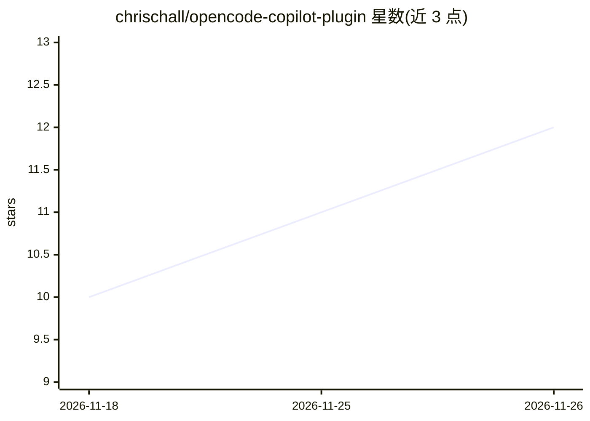

# chrischall/opencode-copilot-plugin

⭐ 12 · TypeScript · MIT · 推送 2026-11-20 · [GitHub](https://github.com/chrischall/opencode-copilot-plugin) · 个人维护

**让 opencode 以组织 M365 Copilot 作为模型后端的插件**

实现 Microsoft 365 Copilot 的未公开 SignalR-over-WebSocket 协议，封装为 OpenAI 兼容代理，并以 opencode 插件形式在进程内启动代理、注册 provider 与模型列表。核心工作是裁剪 opencode 发出的工具集与系统提示（默认保留 shell/read/grep/编辑工具），使其满足 M365 对工具数量的限制；另通过容错解析器、一次性追问、会话路由头与本地回答会话标题等机制维持工具调用。需要 opencode 2 与 M365 账号，无官方开发者 API。

## 筛选速览

| 维度 | 判定 | 备注 |
|---|---|---|
| AI 角色 | `ai-ecosystem` | LLM/agent 周边工具 |
| 许可风险 | `permissive` | MIT |
| 部署形态 | `library` | 以包/库形式分发 |
| 模型依赖 | — | README 未给出锁定关系 |
| 硬件要求 | — | 无带数字的原话,不猜 |
| 安装摩擦 | `low` | 无编译、无系统依赖或容器化 |
| 成熟度 | — | 结构信号不足 |

## 能力要点

- 逆向 M365 Copilot 的 SignalR-over-WebSocket 协议并封装为 OpenAI 兼容代理
- 默认裁剪 opencode 工具与系统提示以规避 M365 的 Disengaged 过滤
- 以 fenced 块协议实现无原生 tool_calls 的工具调用，带容错解析
- 本地回答会话标题以减少会话数消耗

## 适用场景

- 在已有 M365 Copilot 许可的组织内将其接入 opencode 编码代理
- 让 opencode 的模型列表出现 m365/* 系列模型
- 在代理层强制裁剪工具与提示以适配 M365 限制

## 场景标签

`模型网关` · 领域:Agent 开发

## 证据(README 行号)

> L13: package implements that protocol, wraps it in an OpenAI-compatible proxy, and ships an
> L14: opencode plugin that starts the proxy in-process and registers it as a provider.
> L25: npm install -g opencode-m365-copilot

## 星数曲线

2026-11-18 10 → 2026-11-26 12（+2）

---
*卡片 v1 · prompt 1.4 · 生成 2026-11-19 · 置信度 high · 依据 README sha `d2edf7568a77` · [字段定义](../../DATASET.md)*
