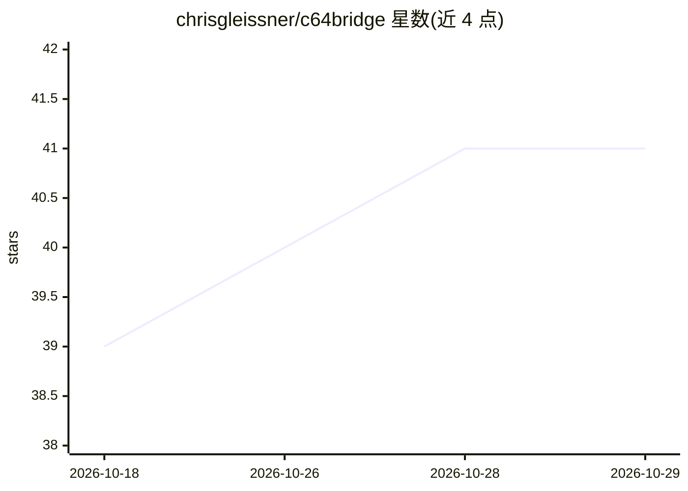

# chrisgleissner/c64bridge

⭐ 41 · TypeScript · GPL-2.0 · 推送 2026-10-15 · [GitHub](https://github.com/chrisgleissner/c64bridge) · 个人维护

**让 AI 客户端通过 MCP 控制和编程 Commodore 64 的服务器**

基于官方 TypeScript @modelcontextprotocol/sdk 构建的 MCP 服务器，供 VS Code、Claude Code、Cursor 等 MCP 客户端的 AI agent 驱动 C64 Ultimate/U64 硬件、U2 系列卡带或 VICE 模拟器：运行 BASIC/6510 汇编/PRG/CRT 程序、读写内存、渲染图形、播放 SID 音乐、操作驱动器与打印机，并可在运行时经 c64_select_backend 切换后端。以 stdio 为入口，可选 HTTP 桥；各后端能力有差异（如 U2 无 machine input 与流式）。需 Node.js 24+，经 npx 或 npm 安装运行。

## 筛选速览

| 维度 | 判定 | 备注 |
|---|---|---|
| AI 角色 | `ai-ecosystem` | LLM/agent 周边工具 |
| 许可风险 | `viral` | GPL-2.0 |
| 部署形态 | `desktop` | 安装包/桌面程序 |
| 模型依赖 | — | README 未给出锁定关系 |
| 硬件要求 | — | 无带数字的原话,不猜 |
| 安装摩擦 | `low` | 无编译、无系统依赖或容器化 |
| 成熟度 | — | 结构信号不足 |

## 能力要点

- 分组 MCP 工具覆盖程序执行、内存读写、图形、声音与系统集成本
- 支持 c64u / u2 / vice 三类后端及运行时切换
- 支持 VICE 可见/最小化/Headless(Xvfb) 三种窗口模式以适配本地与 CI 场景
- 列出官方 MCP Registry，含内置知识与提示资源

## 适用场景

- 通过 VS Code 或 Claude Code 等客户端让 AI 直接操作真实的 C64 硬件
- 在 VICE 模拟器上让 AI 编写并运行 BASIC 或 6510 汇编程序
- CI 或无人值守环境中以 Headless 模式自动化 C64 程序执行与测试

## 场景标签

`编码 Agent` · 领域:编码与开发

## 证据(README 行号)

> L19: C64 Bridge is an MCP server for controlling and working with a Commodore 64 from an AI client.
> L23: It is built on the official TypeScript `@modelcontextprotocol/sdk` and supports both `stdio` for local AI integrati
> L37: 3. Let the client call grouped MCP tools such as `c64_program`, `c64_memory`, `c64_graphics`, and `c64_sound`.

## 星数曲线

2026-10-18 39 → 2026-10-29 41（+2）

---
*卡片 v1 · prompt 1.4 · 生成 2026-10-25 · 置信度 high · 依据 README sha `c8c150ec84f1` · [字段定义](../../DATASET.md)*
